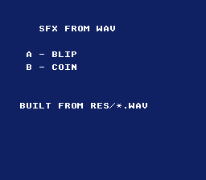

# SFX from WAV



The smallest "press a button, hear a sound" example — and a showcase of the
**`.wav` → `.brr` build rule**. `res/blip.wav` and `res/coin.wav` are ordinary
PCM WAV files; a settings file beside each (`res/blip.wav.toml`, naming
`opensnes-sample`) makes the build convert it to a SNES BRR sample, exactly
the way a `.png` becomes a `.pic`. No `.brr` is committed — they are generated
on demand. Press
**A** for a blip, **B** for a coin.

This is the one-shot / sound-effect counterpart to the SNESMOD examples: for a
jump, a hit, or a UI blip you load a BRR sample directly and trigger it, with no
tracker soundbank involved.

## SNES Concepts

- **BRR samples** — the SNES's ADPCM sample format; the DSP plays BRR, nothing else
- **Direct sample playback** — `audioLoadSample()` uploads a sample to the
  SPC700 once; `audioPlaySample()` triggers it on demand
- **Edge-triggered input** — `padPressed()` fires once per press, so one button
  tap plays one sound
- **Asset pipeline** — a source `.wav` converted at build time from its
  settings file, the `.brr` placed in the asset banks and declared in a
  generated header

## How the WAV becomes a sample

```
res/blip.wav + blip.wav.toml  --opensnes-sample encode-->  res/blip.brr, blip.h, blip_data.as  -->  blip_brr[]
```

```toml
# res/blip.wav.toml
tool = "opensnes-sample"

[encode]
```

`make/common.mk` runs `opensnes-sample encode` for each settings file before
compiling, and links the generated `blip_data.as`; `main.c` includes
`res/blip.h`, which declares `blip_brr[]` and `blip_brr_end[]`. A looping
sample (a sustained tone) adds `loop = [START, END]` to `[encode]`. See
`docs/tutorials/audio.md` (One-shot samples from WAV).

## How to Build

```bash
cd examples/audio/sfx_from_wav
make
```

Run `sfx_from_wav.sfc` in any emulator (or `luna run sfx_from_wav.sfc`).

## Modules Used

`console`, `dma`, `audio`, `input`, `background`, `text`
