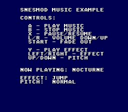

# SNESMOD Music and Sound Effects

Tracker music with transport controls, and sound effects fired over it, with
SNESMOD, the tracker engine that runs on the SNES's sound processor.



## Learning Objectives

After this lesson, you will understand:
- How SNESMOD works (module-based music on the SPC700)
- Loading a soundbank, a module, and sound effects
- Music playback controls (play, stop, pause, volume, fade)
- Playing an effect over the music, with volume, pan and pitch
- How the module, its echo and the effects share the SPC700's 64 KB
- How the build turns `.it` files into a soundbank (`opensnes-music`)

## SNES Concepts

- The SPC700 is a separate processor with its own 64 KB of RAM; the CPU only
  sends it commands through four ports
- `snesmodProcess()` every frame sends the queued commands
- A sound effect is a sample uploaded into the SPC700's RAM after the module,
  played on a voice of its own
- The echo buffer takes the top of that RAM: what is left between the module
  and the echo is all the effects get

## Controls

| Button | Action |
|--------|--------|
| A | Play music |
| B | Stop music |
| X | Pause/Resume toggle |
| L/R | Volume down/up |
| START | Fade out |
| LEFT/RIGHT | Choose the effect (jump, powerup, laser, confirm) |
| UP/DOWN | Its pitch (low, normal, high) |
| Y | Play the effect over the music |

---

## SNESMOD Workflow

```
Impulse Tracker files (.it)          music/nocturne.it  sfx/neo_lumen_sfx.it
         |                                     \             /
         v                                      SOUNDBANK_SRC
    [opensnes-music bank]
         |
         v
soundbank.asm + soundbank.h  ->  linked into the ROM
         |
         v
    [SNESMOD driver on the SPC700]
```

The soundbank holds two modules. `nocturne` is the music. `neo_lumen_sfx` has
no song: it is a list of four instruments, and every sample of a soundbank can
be loaded as an effect. `soundbank.h` names each one after its sample
(`SFX_JUMP`, `SFX_LASER`…).

### Initialization

```c
#include <snes/snesmod.h>
#include "soundbank.h"

snesmodInit();                        /* upload the driver to the SPC700 */
snesmodSetSoundbank(SOUNDBANK_BANK);
snesmodLoadModule(MOD_NOCTURNE);      /* resets the SPC RAM: load effects AFTER it */

u8 jump = snesmodLoadEffect(SFX_JUMP);   /* keep the slot it returns */
snesmodPlay(0);
```

### Main Loop (CRITICAL!)

```c
while (1) {
    WaitForVBlank();
    snesmodProcess();  /* MUST call every frame! */
    // ... game logic ...
}
```

`snesmodProcess()` is what sends the commands (play, stop, volume, sound
effects) to the SPC700. Without it they wait in a queue of 85 and the newest
are dropped once it is full; the music already playing goes on.

### Playback and Effects

```c
snesmodPlay(0);                  /* play from the start */
snesmodStop();
snesmodPause();  snesmodResume();
snesmodSetModuleVolume(255);     /* 0-255, 255 at load */
snesmodFadeVolume(0, 4);         /* target volume, speed */

snesmodPlayEffect(jump, 127, 128, SNESMOD_PITCH_HIGH);   /* slot, volume, pan, pitch */
```

---

## Room for the Effects

Effects are copied into the SPC700's RAM right after the module, and the echo
buffer sits at the top. `opensnes-music inspect` says how much is left:

```
$ opensnes-music inspect music/nocturne.it
music/nocturne.it: "Daveo Nocturne", ... -> 18376 bytes of SPC RAM (30008 free of 48384), 8 BRR sources
```

The nocturne's echo (a delay of 5, 10 KB of buffer) leaves 30 008 bytes. The
four effects take 18 460 of them:

| Effect | Bytes of BRR |
|--------|--------------|
| jump | 4 150 |
| powerup (cut to 0.8 s) | 7 200 |
| laser (cut to 0.5 s) | 4 500 |
| confirm | 2 610 |

**The driver does not check.** An effect loaded past the room is copied over
the echo buffer: the echo overwrites the effect and plays its bytes back as
noise, with no error anywhere. Count the bytes, or ask `inspect`, before
adding an effect to a game with echo — a longer echo delay takes 2 KB a step.

---

## Build & Run

```bash
cd $OPENSNES_HOME
make -C examples/audio/snesmod_music
```

Then run `music.sfc` in luna (`opensnes run`) or any SNES emulator.

---

## Modules Used

`console`, `sprite`, `dma`, `input`, `background`, `text` (`LIB_MODULES` in the Makefile).

## Files

| File | Purpose |
|------|---------|
| `main.c` | UI, transport, effect selection, SNESMOD calls |
| `Makefile` | Build config with SNESMOD rules (`SOUNDBANK_SRC` lists both modules) |
| `music/nocturne.it` | The music: "Daveo Nocturne" |
| `sfx/neo_lumen_sfx.it` | The effects: four samples |
| `soundbank.h`, `soundbank.asm`, `soundbank.bnk` | Generated by the build |

---

## Memory Layout

### ROM
```
Bank 0:    Code
Bank 1:    Soundbank data (its own bank, at its start; more banks if it is larger)
Others:    Tiles, tilemaps and other const data (the asset banks)
```

### SPC RAM, as this example leaves it
```
$0400-$19FF: the SNESMOD driver
$1A00-$61C7: the nocturne: module data and its 8 instruments
$61C8-$A9E3: the four effects (jump, powerup, laser, confirm)
$A9E4-$D6FF: free (11 548 bytes)
$D700-$FEFF: the echo buffer
```

---

## Exercises

1. **A longer echo**: give the nocturne `edl 10` in its song message
   (`devtools/audio_assets/songs.py`), check `inspect` again, and see which
   effects still fit.
2. **Pan**: play the effect left or right of the player (`pan` 0 or 255).
3. **A second song**: add a third `.it` file and switch with SELECT.

---

## Common Issues

### No audio output
- Check `snesmodProcess()` is called every frame
- Verify `snesmodInit()` before `snesmodPlay()`

### An effect sounds wrong, or the echo crackles
- The effect probably does not fit: see "Room for the Effects"
- Effects loaded before `snesmodLoadModule()` are lost: load them after

### Build fails converting the module
- `opensnes-music inspect music/song.it` says what the converter reads in it

---

## What's Next?

**Sound from a WAV:** [sfx_from_wav](../sfx_from_wav/) - effects without SNESMOD

**Graphics:** [Simple Sprite](../../sprites/simple_sprite/) - Display a sprite on screen

---

## Credits

SNESMOD driver by Mukunda Johnson. The program began as PVSnesLib's "music"
and "effects" examples by alekmaul.

"Daveo Nocturne" and its instruments are composed and synthesized for
OpenSNES (`devtools/audio_assets/`, CC0). The four effects are Kenney's
"Digital Audio" and "Interface Sounds" (kenney.nl, CC0).

## License

Code: MIT. The music and the effects: CC0.
