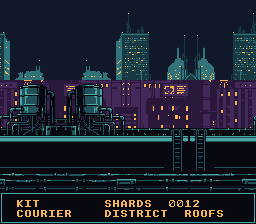

# Mode 0 — 4-Layer 2bpp Background

Demonstrates BG Mode 0 with four independent background layers, each using a 4-color (2bpp) palette.

## Description

Mode 0 provides four background layers, each with its own 4-color palette bank. This example shows the city at night in four layers, each drawn in four colours (one of them transparent), the three behind the status panel scrolling at different speeds.

## Architecture

- **Mode 0**: Four BGs, each 2bpp (4 colors per tile)
- **BG0**: the status panel at the bottom (still)
- **BG1**: the roofs close by (3 px every 3 frames, the fastest)
- **BG2**: the mid-distance blocks (2 px every 3 frames)
- **BG3**: the far towers (1 px every 3 frames, the slowest)
- Each BG uses a separate palette bank (0-3); the backdrop, colour 0 of the first, is the night sky
- Each scrolling layer is a 128-pixel half and its mirror, so it wraps at 256 pixels

The four pictures (`res/bg0.png` to `res/bg3.png`) are written by
`devtools/art_assets/build.py` from the generated city in `assets/neo-lumen/`
(CC0): each source is cut to its band and mapped to its layer's three colours
by brightness.

## Origin

Began as the PVSnesLib "Mode0" example.

## Modules

`console dma background`
