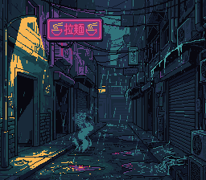

# Mode 1 Example



The most common SNES video mode with two 16-color and one 4-color background.

## Learning Objectives

After this lesson, you will understand:
- Mode 1 layer configuration
- Loading tilesets and tilemaps
- 4bpp tile format basics
- Palette organization

## Prerequisites

- Completed text examples
- Basic understanding of tiles and tilemaps

---

## What This Example Does

Displays a static background image using Mode 1:
- BG1 with 16 colors (4bpp)
- Demonstrates standard SNES background setup
- Foundation for most SNES games

```
+----------------------------------------+
|                                        |
|                                        |
|        [BACKGROUND IMAGE]              |
|                                        |
|                                        |
|                                        |
+----------------------------------------+
```

**Controls:**

| Button | Action |
|--------|--------|
| A | Show BG1 from the LZ77-decompressed copy of the tiles (VRAM $5000) |
| B | Show it from the plain copy (VRAM $4000) |

The picture does not change: that is the point of the second copy.

### The same tiles, compressed

`res/opensnes_lz.png` is the same picture with `lz = true` in its settings
file: the build stores its tiles LZ77-compressed, **652 bytes** in ROM for
the **2592** of the plain copy. At boot the example decodes them straight
into VRAM, in force blank:

```c
#include "res/opensnes_lz.inc"   /* opensnes_lz_tiles[] (compressed), _pal[], _map[] */

lzssDecodeVram(opensnes_lz_tiles, 0x5000);
```

and A / B switch BG1's character base between the two copies
(`bgSetGfxPtr(0, 0x5000)` or `0x4000`) — one register, at any time. With
`lz = true` the `.inc` declares the arrays only, no `BgAsset`: `bgLoad()`
would copy the compressed bytes. A quarter of the ROM for one call at load
time.

---

## Code Type

**C with Library Functions**

| Component | Type |
|-----------|------|
| Background setup | Library (`bgSetMapPtr`, `bgInitTileSet`) |
| Tilemap loading | Library (`dmaCopyVram`) |
| Mode setting | Library (`setMode`) |
| Screen enable | Library (`setScreenOn`) |

---

## Mode 1 Overview

Mode 1 is the most popular SNES video mode:

| Layer | Color Depth | Colors | Typical Use |
|-------|-------------|--------|-------------|
| BG1 | 4bpp | 16 | Main playfield |
| BG2 | 4bpp | 16 | Secondary layer |
| BG3 | 2bpp | 4 | Status bar, text |
| Sprites | 4bpp | 16 per palette | Characters, objects |

### Games Using Mode 1

- Super Mario World
- The Legend of Zelda: A Link to the Past
- Street Fighter II
- Final Fantasy IV/V/VI
- Chrono Trigger

---

## Basic Setup

### 1. Configure Video Mode

```c
setMode(BG_MODE1, 0);  /* Mode 1, no special options */
```

### 2. Set Up Background

```c
/* Tilemap at VRAM $1000, 32x32 tiles */
bgSetMapPtr(0, 0x1000, SC_32x32);

/* Load tiles and palette */
bgInitTileSet(0, tiles, palette, 0,
              tiles_size, palette_size,
              BG_16COLORS, 0x4000);

/* Load tilemap */
dmaCopyVram(tilemap, 0x1000, tilemap_size);
```

### 3. Enable Display

```c
REG_TM = TM_BG1;  /* Show BG1 on main screen */
setScreenOn();
```

---

## VRAM Layout

A typical Mode 1 VRAM layout:

```
$0000-$0FFF: BG1 tilemap (32x32 = 2KB)
$1000-$1FFF: BG2 tilemap (optional)
$2000-$3FFF: BG3 tilemap (optional)
$4000-$7FFF: Tile graphics (16KB available)
```

### Tilemap Format

Each tilemap entry is 2 bytes:

```
Byte 0: Tile number (0-255)
Byte 1: vhopppcc
         v = Vertical flip
         h = Horizontal flip
         o = Priority
         ppp = Palette (0-7)
         cc = Tile high bits (for >256 tiles)
```

---

## 4bpp Tile Format

Mode 1 uses 4 bits per pixel (16 colors):

```
Each 8x8 tile = 32 bytes
- Bitplanes 0-1: 16 bytes (like 2bpp)
- Bitplanes 2-3: 16 bytes (additional color bits)

Row layout: BP0, BP1, BP0, BP1... (16 bytes)
            BP2, BP3, BP2, BP3... (16 bytes)
```

---

## Build & Run

```bash
cd $OPENSNES_HOME
make -C examples/backgrounds/mode1
```

Then open `mode1.sfc` in luna (`luna-gui mode1.sfc`) or any emulator.

---

## Modules Used

`console`, `sprite`, `dma`, `background`, `asset`, `lzss`, `input` (`LIB_MODULES` in the Makefile).

## Files

| File | Purpose |
|------|---------|
| `main.c` | Background setup code |
| `res/opensnes.png.toml` | the import settings of the picture (`opensnes-tileset`, 16 colours); the build converts it and links the result, `res/opensnes.inc` declares the `BgAsset` |
| `res/opensnes_lz.png.toml` | the same picture with `lz = true`: its tiles are linked LZ77-compressed, `res/opensnes_lz.inc` declares the arrays |
| `Makefile` | Build configuration (`LIB_MODULES := console sprite dma background asset lzss input`) |
| `res/` | Source graphics files |

---

## Exercises

### Exercise 1: Add a Second Layer

Enable BG2 with a different tileset:
```c
bgSetMapPtr(1, 0x1800, SC_32x32);
bgInitTileSet(1, tiles_bg2, palette, 1, ...);
REG_TM = TM_BG1 | TM_BG2;
```

### Exercise 2: Change Palette

Modify colors by writing to CGRAM:
```c
REG_CGADD = 0;  /* Start at color 0 */
REG_CGDATA = 0x00; REG_CGDATA = 0x00;  /* Black */
REG_CGDATA = 0xFF; REG_CGDATA = 0x7F;  /* White */
```

### Exercise 3: Tile Flip

Modify tilemap entries to flip tiles:
```c
/* Horizontal flip: set bit 6 of attribute byte */
tilemap_entry = tile_num | (1 << 14);
```

### Exercise 4: Add Priority

Use BG3 for a status bar that appears over BG1:
```c
bgSetMapPtr(2, 0x2000, SC_32x32);
/* Set BG3 priority higher in tilemap entries */
```

---

## Technical Notes

### Mode 1 Priorities

Default priority (back to front):
1. BG3 (lowest)
2. BG2
3. BG1
4. Sprites (can be interleaved)

Priority bit in tilemap flips individual tiles to front.

### BG3 Specifics

BG3 in Mode 1 is only 2bpp (4 colors) but has special priority behavior. It's commonly used for:
- HUD overlays
- Text displays
- Status bars

### Color Palette

Mode 1 palette organization:
- Colors 0-15: BG1 palette
- Colors 16-31: BG2 palette
- Colors 32-35: BG3 palette (only 4 colors)
- Colors 128-255: Sprite palettes

---

## What's Next?

**More BG layers:** [Panel HUD](../../basics/panel_hud/) - a HUD on BG3, in front of the scene

**Sprites:** [Simple Sprite](../../sprites/simple_sprite/) - Display a sprite

**Effects:** [Fading](../../transitions/fading/) - Screen transitions
