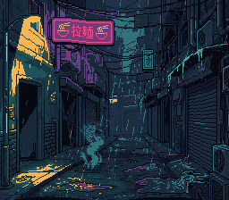
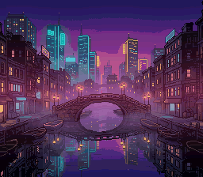

# mode2 — offset-per-tile in Mode 2 and Mode 4: per-column scroll from BG3

**Backgrounds · the offset-per-tile modes (2/4/6).**

## Why it matters for your game

Modes 2, 4 and 6 have a trick no other mode offers: **offset-per-tile
(OPT)** lets every 8-pixel *column* of a layer scroll independently. That is
how you get a flag rippling in the wind, a heat-haze shimmer, water
distortion, or cheap per-column parallax — effects that would otherwise cost
a scanline of HDMA or a full software redraw. It is niche, but when you want
it, nothing else does it as cheaply.



## What you'll learn

The single idea: in Mode 2, **BG3 stops being a drawable layer and becomes
an offset table.** For each column of BG1/BG2, the PPU reads a scroll offset
straight out of BG3's tilemap:

- Per screen column *N ≥ 1* (column 0 can't be offset), the PPU reads BG3
  **tile-row 0** for the horizontal offset word and **tile-row 1** for the
  vertical offset word.
- **Offset word:** bit `0x2000` = apply to BG1 (`0x4000` = BG2); the V value
  is bits 0–9, the H value bits 3–9 (8-pixel-granular).

This example puts the Rue basse under the rain on BG1 (the 4bpp picture of
[mode1](../mode1/)) and writes a small sine into BG3's V-offset row, so each
column shows the street a few lines higher or lower: the air shimmers like
the heat over a steam vent. The phase advances each frame.

- **A vertical word is the raw scroll value.** It replaces the layer's
  `VOFS` for its column entirely (snesdev-wiki, *Offset-per-tile*: "Vertical
  entries will replace the BG VOFS value entirely"), so the -1 the lib adds
  to a vertical scroll (KNOWN_LIMITATIONS, "Vertical scroll is off by one")
  is not in it. A word of `0x3FF` (-1) puts a column where column 0 is; the
  wave here goes from -1 to 2 lines. **Modes 4 and 6
reuse this exact data path**, and press **B** for Mode 4.

### Mode 4: one row, one word per column (B)



Mode 4 gives you an 8bpp (256-colour) BG1, a 2bpp BG2, and — like Mode 2 —
BG3 as the offset table. The difference is the table: Mode 4 reads **one
row** of it, so each column gets one word, either vertical or horizontal:

- **The Mode 4 offset word:** bit 15 = 1 vertical, 0 horizontal; bit 13 =
  apply to BG1 (bit 14 = BG2); the value in bits 0–9, of which a horizontal
  offset ignores the low 3 (snesdev-wiki, *Offset-per-tile*).
- **One row:** BG3 row 0 holds the 32 words; word 0 applies to the second
  visible column — the leftmost column is never offset.
- **BG3VOFS picks the row:** `bgSetScroll(2, 0, 0)` reads row 0. The lib
  writes BG3's VOFS raw in Modes 2/4/6 (for a displayed layer it writes
  `y - 1`; see KNOWN_LIMITATIONS, "Vertical scroll is off by one").

Here BG1 is the canal at night in 256 colours (the 8bpp picture of
[mode3](../mode3/), with eight mirrored rows added below it for the lines the
wave lowers into view), and the same sine goes into the row as vertical
words: the columns ripple. Press **A** and it goes in as horizontal words:
the columns slide sideways, 0 to 24 pixels, 8 at a time. **B** again goes
back to Mode 2.

The two pictures do not fit in VRAM together (28 KB of 4bpp tiles, 50 KB of
8bpp), so a switch reloads the scene in force blank (`setScreenOff`, the
tiles, the map and the palette by DMA, `setMode`, `setScreenOn`): one dark
frame. VRAM: the scene's tiles at `$0000` (the canal's second part at
`$4000`), BG1's map at `$7000`, the offset table at `$7400`.

## What to observe / if it breaks

- **Correct run:** the street shimmers as a travelling wave; each 8-pixel
  column is at its own vertical offset (look at the noodle sign's edges), all
  from one 32-entry BG3 table.
- **The street stays still:** the offset table never reached VRAM. The classic cause
  is computing it *after* `WaitForVBlank` — the upload then runs past VBlank
  and the PPU drops it. Build the table during active display, DMA it the
  instant VBlank starts (what this example does).
- **Only the leftmost column is wrong:** column 0 cannot be offset by OPT —
  that is hardware, not a bug.
- **Every column but the first sits one line too high:** the words carry the
  lib's -1 convention twice, or not at all. They are raw values (above).
- **Whole layer shifts uniformly (no ripple):** your offset words are missing
  the `0x2000` enable bit, so the PPU ignores them and uses the base scroll.

Probe oracle: `wave_phase` advances every frame. The luna manifests
`dma_mode2_opt_table.toml` (Mode 2: the two rows, word by word, at a given
loop iteration) and `backgrounds_mode2_mode4.toml` (B, then A: the vertical
words, then the horizontal ones) check it.

## Controls

| Button | Action |
|--------|--------|
| B | Switch between Mode 2 and Mode 4 |
| A | In Mode 4: vertical words ⇄ horizontal words |

## Build & run

```bash
make
../../../testing/bin/luna run -n 3000000 mode2.sfc
```

## Modules used

`console`, `dma`, `background`, `input`, `math`

## Assets

| File | What | Made by |
|---|---|---|
| `res/street.png` | the rainy street, 16 colours, 4bpp (`res/street.png.toml`) | mode1's file, copied by `devtools/art_assets/build.py` |
| `res/canal.png` | the canal at night, 253 colours, 8bpp, 256x232 (`res/canal.png.toml`) | `assets/neo-lumen/backgrounds/canal_256.png`, its last eight rows mirrored below it (`mode2_canal` in `build.py`) |

CC0, like the rest of the Néo-Lumen assets (`assets/neo-lumen/README.md`).

## Where you are

← the rest of the family covers the everyday modes
([mode1](../mode1/), [mode0](../mode0/), [mode3](../mode3/),
[mode5_hires](../mode5_hires/)); this rung is the specialist OPT modes. For per-scanline
(rather than per-column) tricks, see the [hdma](../../hdma/) family.
