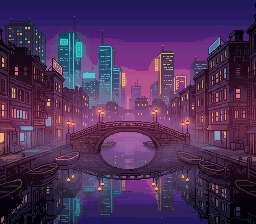

# Mode 3 — 256-Color Background

Demonstrates BG Mode 3 with a single 256-color (8bpp) background layer.

## Description

Mode 3 provides one 256-color background, allowing photographic-quality images on the SNES. The picture is a city canal at night in 253 colours: the haze over the water fades through dozens of shades, which no 16-colour palette could hold. Its tileset (770 tiles, 48 KB) is larger than a ROM bank, so the converter writes it in two parts, and `canal_tiles_load()`, which the converter writes in `canal.inc`, copies both with `dmaCopyVram()`, whose pointer carries the bank.

## Architecture

- **Mode 3**: BG1 at 8bpp (256 colors), BG2 at 4bpp (16 colors, unused here)
- **BG1**: Full 256-color image
- Tileset in two parts (`canal_tiles`, `canal_tiles_1`), loaded by the generated `canal_tiles_load()`: one DMA transfer per part
- VRAM: tiles at $0000 (770 x 32 words, up to $6040), tilemap at $7000
- Picture converted by the build from `res/canal.png` (`res/canal.png.toml`):
  generated for OpenSNES, CC0 (`assets/neo-lumen/`), its haze added by hand

## Origin

Began as the PVSnesLib "Mode3" example.

## Modules

`console dma background`
