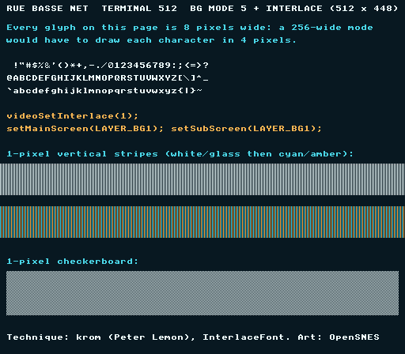

# Hi-res text — BG Mode 5 + interlace (512 × 448)



Port of krom (Peter Lemon)'s **InterlaceFont** demo
([PeterLemon/SNES](https://github.com/PeterLemon/SNES), `PPU/Interlace/InterlaceFont`).
BG Mode 5 renders **512 horizontal pixels** with 16×8 tiles; SETINI bit 0
adds screen interlace for **448 visible lines**. This example lands the
SDK's SETINI surface (`videoSetInterlace/ObjInterlace/Overscan/PseudoHires`,
all composing through a write-only-register shadow) with a text page as
the canonical hi-res payload — every glyph is 8 px wide, unrepresentable
at 256.

The page is a screen of the Rue basse's terminal, 63 columns of the
library's 8x8 font in the city's colours (white, cyan and amber on the
glass), drawn and converted to Mode 5's paired-tile format by
`devtools/art_assets/build.py` (`hires_page`); the outputs are committed. The
1-pixel stripe/checker bands are the acid test: at true 512 px they
alternate every column — a 256-wide mode would alias them to flat gray.

## SNES Concepts

- BG Mode 5: 512 px, 16×8 tiles stored as 8×8 character pairs (N, N+1)
- SETINI ($2133) via `videoSetInterlace()` — write-only shadow discipline
- **The Mode 5 trap**: content displays through main AND sub screen —
  `setMainScreen(LAYER_BG1); setSubScreen(LAYER_BG1);` — main-only leaves the
  even columns (the sub screen's) blank
- Interlace vertical addressing: tile texel rows map 1:1 to hi-res lines,
  so a full 448-line page needs 56 tile rows → a 32×64 tilemap

## Understanding what you see

Mode 5's 512 columns interleave the sub screen (even columns) and main
screen (odd columns) — a period CRT blended adjacent columns into smooth
strokes, while a modern LCD's crisp pixel grid shows them individually:

- **Text looks slightly "double-struck"** — those are the real alternating
  columns. Authentic PPU output (hi-res games like Seiken Densetsu 3 show
  the same fringing in emulators); a CRT melts it into clean strokes.
- **The white/glass 1-px band reads as flat gray** — 1-px columns are
  finer than typical window scaling can resolve. That IS the acid test:
  at 256 wide this band couldn't exist at all. On a CRT it shimmers.
- **The cyan/amber band still resolves into visible stripes** — its period
  is 4 px (2 px per color), coarse enough to survive scaling: direct
  visual proof you are looking at 512 columns.
- **The 1-px checkerboard reads as gray** — same physics, both axes.

## Register fidelity vs the original

| Register | krom | this port |
|---|---|---|
| BGMODE | `$0D` (Mode 5, priority, 16×8) | same (`setMode(BG_MODE5, 0x08)`) — verified `$0D` in luna |
| SETINI | `$01` | same (`videoSetInterlace(1)`) — verified `$01` |
| TM / TS | `$01` / `$01` | same (`setMainScreen`+`setSubScreen`) — verified |
| BG1SC | map word $4000 | same (`bgSetMapPtr`), 32×64 (krom: 64×32 — his page is wider, ours taller) |
| BG12NBA | tiles word $8000 | same (`bgSetGfxPtr`) — verified |

## Validation notes

The screenshot above is luna's capture at native resolution
(`luna run --native-res`, 512×448: the field pair, every column), and the
visual baseline is taken the same way. The full 448-line page displays once
with no vertical wrap (the 32×64 map: a 32-row map only covers 256 hi-res
lines in interlace).

## How to Build

```bash
cd examples/backgrounds/mode5_hires && make
# redraw the page (contributors, needs Pillow):
python3 ../../../devtools/art_assets/build.py && make
```

## Modules Used

`console`, `dma`, `background`

## Assets

| File | What | Made by |
|---|---|---|
| `res/text.pic`, `res/text.map`, `res/text.pal` | the page as Mode 5 reads it: 4bpp tile pairs, a 32×64 map, four colours | `devtools/art_assets/build.py` (`hires_page`) |
| `res/source.png` | the page itself, 512×448, for reference | the same |

CC0, like the rest of the Néo-Lumen assets (`assets/neo-lumen/README.md`).

## Further: Mode 5 without interlace (512 x 256)

The plain Mode 5 picture is this
program minus `videoSetInterlace()`: 512 pixels wide at 256 lines, 16x8
tiles stored as pairs of 8x8 characters (N on the left half, N+1 on the
right), loaded with `bgInitTileSet()` at 4 bpp for BG1 and 2 bpp for BG2. The
same two traps apply — the layer shows through main AND sub screen, and the
VRAM budget doubles (24 KB of interleaved tiles for one screen).
