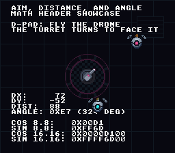

# aim_target



Live demonstration of the four math primitives a 2D action game leans on
the most: **`sqrt16`** (pixel distance), **`atan2_8`** (8-bit angle to a
target), and the **`fixCos` / `fixSin` LUTs** (project a velocity vector
along that angle). Everything updates live as the user moves the target
with the D-pad — the numbers on screen are real arithmetic, not pre-baked.

A security turret sits on a roof at the screen centre; the drone it aims at
follows the D-pad. Each frame the example recomputes `dx`/`dy` from the two
centres, calls `sqrt16(dx² + dy²)` for the pixel distance, calls
`atan2_8(dy, dx)` for the 8-bit angle, then calls `fixCos` and `fixSin`
on that angle to read back the unit direction vector — and turns the
turret to face the drone with the same angle.

A second drone, its eye cyan, orbits the roof on its own: the motion half of
the fixed-point story (it was the `fix32_orbit` example).

## SNES Concepts

- `<snes/math.h>` square-root and atan2:
    - `sqrt16(n)` → integer floor of √n, range 0–255
    - `atan2_8(dy, dx)` → 8-bit angle in the same convention as the
      `fixSin` / `fixCos` LUTs (0 = +X, 64 = +Y, 128 = −X, 192 = −Y)
- LUT chaining — feed the `atan2_8` output back into the trig LUT to
  recover a unit direction vector that points from the turret to the drone.
  This is the canonical pattern for projectile aiming, pursuit AI,
  and any "rotate sprite to face X" code.
- Facing a target with no rotation hardware — the turret is drawn in
  sixteen headings, a sixteenth of a turn (16 angle steps) apart, and the
  angle picks the frame: `(angle + 8) >> 4`, half a step added so that the
  NEAREST heading wins, not the one just below.
- Mode 0 + sprite overlay — BG1 hosts the text via the `text` module,
  BG2 the roof (2bpp, its own four colours at CGRAM 32: in Mode 0 each BG
  has its own palettes), in front-to-back order BG1, BG2. The turret and
  the drones are 32×32 OBJ sprites over both. Sprite tiles are placed at
  VRAM $4000 to keep $0000 free for the text font; the sheet holds 264
  tiles, so the drones sit in the second OBJ name table (tiles 256, 260).
- A sprite's position is its top-left corner. The example keeps the
  centres — what the maths aims between — and draws each 32×32 sprite 16
  pixels up and left of its centre.
- `<snes/fixed32.h>` motion, the orbiter — **keep the world in 16.16 and
  the screen in 8.8**:
    - an angle accumulator in 16.16 (`fixed32`), advanced each frame by a
      16.16 angular velocity (`FIX32(1)`: one LUT step a frame)
    - its integer part (`UNFIX32`) indexes the 256-step LUT
    - the position is `fix32Mul(radius, fix32Cos(angle))` and the same with
      `fix32Sin`, around (128, 96) at 60 px, and only the final screen
      position is narrowed to integers

## What to Observe

The live readout panel updates every frame:

- `DX` / `DY` — signed distances from the turret to the drone (the text
  module prints a `u16`: the example writes the sign, then the magnitude)
- `DIST` — `sqrt16(dx² + dy²)` in pixels (0–255)
- `ANGLE` — 8-bit angle from the turret to the drone (hex), with the
  equivalent in degrees in parentheses (≈ angle × 360 / 256)
- `COS` / `SIN` — 8.8 fixed-point components of the unit direction
  vector. Their values match the angle: at `ANGLE = 0x40` (90°,
  target straight south on a SNES screen) you see `COS = 0x0000`
  and `SIN = 0x0100`.

Fly the drone around with the D-pad and watch the entire panel react in
real time, the turret's barrel following. The cyan drone circles at one LUT
step a frame (an orbit in about 4.3 s at 60 Hz), whether you move or not; it
crosses the text, as sprites do over a background.

## How to Build

```sh
make -C examples/basics/aim_target
```

The ROM lands at `examples/basics/aim_target/aim_target.sfc`.

## Assets

`res/units.png` — the turret's sixteen headings (OBJ palette 0), the
security drone (palette 1) and its cyan twin (palette 2); `res/roof.png` —
the roof, four colours. The turret and the roof are drawn by
`devtools/art_assets/build.py` (`turret`, `aim_sprites`, `rooftop`), the
drone is Néo-Lumen art (PixelLab, CC0; `assets/neo-lumen/README.md`). The
build converts both from the settings file beside each (`opensnes-sprite`,
`opensnes-tileset`).

## Modules Used

`console`, `sprite`, `dma`, `background`, `text`, `input`, `gameloop`,
`math`.

Also linked: `fixed32` — 32-bit fixed point (`fix32*`).

## See also

- [`docs/tutorials/math.md`](../../../docs/tutorials/math.md) — the
  full fixed-point math tutorial, including the section on
  `sqrt16`/`atan2_8`.
- [`lib/include/snes/math.h`](../../../lib/include/snes/math.h) —
  Doxygen reference for the math API.
