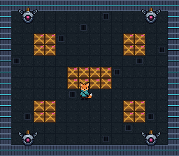

# Collision Detection Demo

> AABB sprite-vs-sprite and tile-based wall collision in a warehouse.
> Walk Kit with the D-pad between the crates. A drone he walks under turns its lights green.



## Controls

| Button | Action |
|--------|--------|
| D-Pad | Walk Kit (2 pixels/frame) |

## What You'll Learn

- AABB collision via `collideRect()` with `Rect` struct pointers
- Tile-based wall collision via `collideTileEx()` with a collision map of 16x16 cells
- Per-axis rejection for sliding along walls instead of stopping dead
- One array for the walls and the picture: the tilemap is built from the collision map
- A hitbox smaller than its sprite, and the sprite drawn from the box
- Palette swapping for visual collision feedback

---

## Build & Run

```bash
cd $OPENSNES_HOME
make -C examples/basics/collision_demo
```

Then open `collision_demo.sfc` in luna (`luna-gui collision_demo.sfc`) or any emulator.

## SNES Concepts

### AABB Collision with Rect Pointers

`collideRect()` takes two `Rect*` pointers and returns non-zero if the rectangles
overlap. The `Rect` struct holds `x`, `y`, `width`, and `height` fields:

```c
player_box.x = player_x;
player_box.y = player_y;
player_box.width = BOX_SIZE;
player_box.height = BOX_SIZE;

if (collideRect(&player_box, &enemy_box[i])) {
    collision_flags |= (1 << i);
}
```

The example checks Kit against four drones each frame, storing results in a bitmask
(`collision_flags`). Bit N set means drone N is overlapped. Two boxes that only touch
edge to edge do not overlap.

### Tile-Based Wall Collision

`collideTileEx()` takes a pixel position, the collision map, its width in cells and
the cell size in pixels (8, 16 or 32; `collideTile()` is the 8-pixel case):

```c
collideTileEx(x, y, collision_map, MAP_WIDTH, CELL)
```

It divides the position by the cell size and returns the cell's value, non-zero for
solid. The map here is 16x14 cells of 16 pixels, the whole screen, so screen
coordinates are map coordinates. The example checks all four corners of Kit's 16x16
box.

### Per-Axis Sliding

When a diagonal movement would collide, each axis is tested independently. If only
the X component collides, the Y movement still applies (and vice versa). This lets
Kit slide along walls:

```c
if (!check_wall_collision(new_x, new_y)) {
    player_x = new_x;
    player_y = new_y;
} else {
    if (!check_wall_collision(new_x, player_y)) player_x = new_x;
    if (!check_wall_collision(player_x, new_y)) player_y = new_y;
}
```

### One Array for the Walls and the Picture

```
2,2,2,2,2,2,2,2,2,2,2,2,2,2,2,2   (the north wall)
2,0,0,0,0,0,0,0,0,0,0,0,0,0,0,2
...
2,0,0,1,1,0,0,0,0,0,0,1,1,0,0,2   (crate stacks)
...
2,0,0,0,0,0,1,1,1,1,0,0,0,0,0,2   (the middle stack)
...
2,2,2,2,2,2,2,2,2,2,2,2,2,2,2,2   (the south wall)
```

0 is the floor, 1 a crate, 2 a wall plate: both solid, drawn differently. At boot,
`build_tilemap()` turns each cell into the 2x2 tiles of its picture in `res/cells.png`
(and a floor cell into a drain grate now and then, chosen from its position), one row
of 32 map entries at a time, one DMA a row, in force blank. Move a crate in the array
and it moves on screen and in the collisions at once.

### A Hitbox Is Not a Sprite

Kit is a 32x32 sprite, but what collides is a 16x16 box at his feet: the sprite is
drawn 8 pixels left of the box and 16 above it, so his head may pass in front of a
crate he stands below, as in a game seen from above. The drones' boxes are their
bodies, 8 pixels into their frames each way.

### Palette Feedback and Drawing Order

Each drone is drawn on OBJ palette 1 (pink lights) or, while its bit is set, palette 2:
the same colours with the lights green. Same tiles, another palette, nothing to
upload. The drones take OAM slots 0-3 and Kit slot 4: the lower slot is drawn in
front, and the drones fly, so a drone Kit walks under stays visible.

---

## VRAM Layout

From `vram.spec` (`vram_map.h` is generated from it):

| Region | Content |
|--------|---------|
| $0000 | OBJ tiles: Kit's 15 frames and the drone's 4, 32x32 (320 tiles) |
| $1400 | BG1 tilemap, 32x32 |
| $2000 | BG1 tiles: the four 16x16 cells (16 tiles) |

## Assets

`res/cells.png` (the floor, a crate, a wall plate, the floor with a drain, converted
without reduction so that cell k is tiles 2k, 2k + 1, 8 + 2k, 9 + 2k) and
`res/cast.png` (Kit's walk from above, then the drone's hover) are made by
`devtools/art_assets/build.py` (`warehouse_cells`, `collision_sprites`); Kit and the
drone are Néo-Lumen art (PixelLab, CC0; `assets/neo-lumen/README.md`). The build
converts both from the settings file beside each (`opensnes-tileset`,
`opensnes-sprite`).

## Modules Used

`console`, `input`, `sprite`, `dma`, `collision`, `background` (`LIB_MODULES` in the Makefile).

## Files

| File | Purpose |
|------|---------|
| `main.c` | Collision logic, the tilemap built from the map, sprite placement, game loop |
| `vram.spec` | The VRAM regions; `vram_map.h` is generated from it |
| `Makefile` | Build config (`LIB_MODULES := console input sprite dma collision background`) |

## What's Next?

**Game:** [Breakout](../../games/breakout/) - Complete game with collision, sprites, and levels
