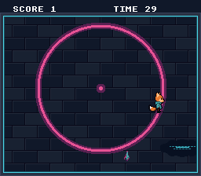

# game_skeleton — the smallest complete game

**Game math & framework · a capstone.**

## Why it matters for your game

Every example so far teaches one system. This one teaches the *shape that
holds them together*: a title screen, a play loop with a goal and a clock,
and a game-over screen that loops back. It's small enough to read in one
sitting and fork as the starting point for your own game.



## What you'll learn

The single idea: **a game is a state machine around one frame loop.** Every
frame you `WaitForVBlank()`, read the pad, then `switch (game_state)` to the
code for the screen you're on. A transition is just an assignment to
`game_state` plus a one-time setup for the new screen:

```
TITLE  --START-->  PLAY  --timer hits 0-->  OVER  --START-->  TITLE
```

It recombines rungs you've climbed: **input** walks Kit across a square of the
Rue basse, a second **sprite** is the data shard, a **bounding-box** test scores
it, **text** is the HUD, and `rngNext()`/`rngSeed()` scatter the shard. Motion and
collision are deliberately simple — the lesson is the *structure*, not the
mechanics.

Each screen is a choice of layers. The game is in Mode 1: BG1 is the play
square, BG2 the logo, BG3 the text in front of both. The title and game-over
screens show BG2 and BG3, play shows BG1, BG3 and the sprites — one
`setMainScreen()` call per transition, everything loaded once at boot.

The pickup boxes are 8x8, smaller than the sprites drawn round them (Kit is
32x32, drawn so that his box is at his feet; the shard 16x16, centred on its
box): what scores is what touches, not what overlaps by a pixel of hair.

When the enum + switch starts to sprawl in a bigger game, the opt-in `scene`
framework is the next step up — see [scene_stack](../scene_stack/).

## What to observe / if it breaks

- **Correct run:** the title shows the logo and `PRESS START`; in play the
  D-pad walks Kit (he faces the way he walks), reaching the shard bumps
  `SCORE` and respawns it, `TIME` counts down; at zero the game-over screen
  shows the final score; START plays again.
- **Nothing happens on START:** input is read with `padPressed` (edge) — a
  held button fires once; that's intended for menu transitions.
- **Sprites invisible in play:** `setMainScreen(LAYER_BG1 | LAYER_BG3 | LAYER_OBJ)`
  must enable OBJ.
- **Kit cut to a 16x16 corner:** `oamClear()` (the title calls it) resets
  every size bit; `start_game()` sets Kit's back to `OBJ_LARGE`.
- **Number smears (`10` → `9` leaves `90`):** clear the field before
  reprinting — this example prints spaces over the old digits first.

Probe oracles: `game_state` (0 title / 1 play / 2 over), `score`, `time_left`.

## Build & run

```bash
make
../../../testing/bin/luna game_skeleton.sfc   # luna-gui: tap START, steer with the D-pad
```

## Assets

`res/field.png` (a piece of the square of `sprites/world_sprites`, with a kerb
round the field and a band for the HUD), `res/logo.png` (the OpenSNES logo) and
`res/cast.png` (Kit's walk from above, then the shard turning in eight frames)
are made by `devtools/art_assets/build.py` (`skeleton_field`, `screen_logo`,
`skeleton_sprites`) from the Néo-Lumen art (CC0; `assets/neo-lumen/README.md`).
The build converts them from the settings file beside each.

## Modules used

`console`, `dma`, `background`, `sprite`, `text`, `input`

## Where you are

The capstone of the basics family — it ties input, sprites, text and a state
machine into a whole game. For the same structure via the `scene` framework,
see [scene_stack](../scene_stack/); for a HUD box, [panel_hud](../panel_hud/).
