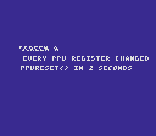

# ppu_reset — the next screen starts from a clean PPU

**Game math & framework · between two screens.**

A game is a chain of screens. Each one sets the PPU registers it needs, and
every register it does not set keeps what the previous screen left:
`consoleInit()` rewrites only a few of them. `ppuReset()` rewrites all of
them, to the value they had at power-on, and puts the library's shadows back
with them. Screen A here changes nearly every PPU register; two seconds later
the program calls `ppuReset()` and sets up screen B the way a first screen is
set up. Screen B shows nothing of screen A.



*Screen A: Mode 1, the text on BG3, scrolled, tinted by color math, in 2×2
mosaic blocks, and waving under an HDMA channel.*

## What you'll learn

- The PPU registers are write-only and keep their value until written: a
  screen inherits every register the previous one set and it does not.
- `ppuReset()` between two screens, before the setup of the next one, undoes
  all of it: HDMA stopped, every register from `$2100` to `$2133` at its
  power-on value (forced blank, BG mode 0, all map and tile bases 0, scrolls
  at their start, Mode 7's identity matrix, windows and color math off), the
  library's shadows (scrolls, mosaic, color math, windows, Mode 7, HDMA,
  brightness, a running fade) back with them, every sprite hidden.
- What it leaves alone: the contents of VRAM, CGRAM and OAM, the audio, the
  NMI and joypad settings. The next screen still loads its own tiles, maps
  and palettes, and calls `setMode()`.

## What to look at

- Screen A for two seconds: waving, tinted, blocky white text on blue.
- Screen B: plain white text on green, in place, no wave, no tint.
- Remove the `ppuReset()` call in `main()` and rebuild: screen B keeps BG1's
  scroll from screen A (the text moves 33 pixels) and the tint on the
  backdrop.

## How it is checked

`testing/manifests/basics_ppu_reset.toml` reads the PPU registers (luna's own
view of them) and the library's shadows twice: at `main()`, before the
program writes anything, and at the first instruction of `screen_b_setup()`,
right after `ppuReset()`. Both readings must give the same values. Built
without the `ppuReset()` call, the ROM fails 80 of those checks.

## How to build

```bash
make -C examples/basics/ppu_reset
```

## Modules used

`console`, `dma`, `text`, `background`, `sprite`, `colormath`, `mosaic`,
`window`, `mode7`, `hdma`, `ppu_reset`
