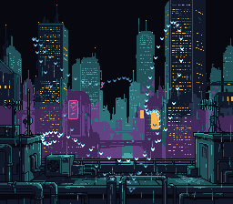

# SA-1 Starfield (Murmuration)

> 128 neon moths in Lissajous sine patterns computed by the SA-1 coprocessor,
> a cloud over the city's far skyline in the rain



## What You'll Learn

- SA-1 computing 128 sprite positions per frame using sine harmonics
- I-RAM as a shared buffer: SA-1 writes positions, SNES CPU reads them
- One tiny sprite for all 128 (a 4x3 moth in an 8x8 tile): a cloud this dense
  bunches up, and a scanline shows at most 32 sprites
- Depth illusion via 4 brightness palettes cycling across sprites
- Synchronization protocol between SA-1 and main CPU
- Running SA-1 code from I-RAM: copy it there, keep it position-independent

## Build & Run

```bash
cd $OPENSNES_HOME
make -C examples/chips/sa1_starfield
```

Then open `sa1_starfield.sfc` in luna (or any SNES emulator).

## What to Observe

- 128 moths moving in smooth, coordinated flock-like patterns over the skyline
- The pattern resembles a murmuration (starling flock)
- 4 brightness levels create a subtle depth effect
- All math computed by the SA-1, from I-RAM: at boot it copies its loop and
  sine table there, so it does not share the ROM with the main CPU (~10.7 MHz;
  ~8.5 MHz when built with `make clean && make SA1_CODE_IN=ROM` — see the
  SA-1 tutorial for the measurement)

## Assets

`res/mote.png` (the moth) is drawn by `devtools/art_assets/build.py` (`MOTE`);
`res/skyline.png` is `backgrounds/city_far.png` (PixelLab, CC0,
`assets/neo-lumen/README.md`).

## Modules Used

| Module | Purpose |
|--------|---------|
| console | System initialization |
| sprite | OAM management |
| dma | DMA transfers |
| background | BG configuration |
| input | Joypad reading |
| sa1 | SA-1 coprocessor driver |
