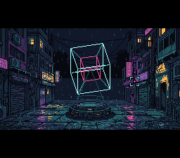

# Super FX Game Skeleton

> The shape of a Super FX game: the game runs every frame, the GSU renders
> on its own clock, the NMI puts finished frames on screen.



A square of the city at night, in the rain. Above the projector in its
middle, a hologram turns and bobs: a data cube, a pink cube inside it, the
struts between them, and the two beams that rise from the projector's rim.
The GSU draws it at 30 frames per second while a sight follows the D-pad at
60 and SNESMOD music plays. Neither waits for the other: the renderer runs
from the GSU's code cache, so the CPU keeps the ROM and its game loop;
`gsuPresent()` double-buffers the frames, and the NMI moves each one to VRAM
a piece per VBlank, showing it only once all of it has landed.

## Build & Run

```bash
cd $OPENSNES_HOME
make -C examples/chips/superfx_game_skeleton
```

Then open `superfx_game_skeleton.sfc` in luna (or bsnes). Hold the D-pad.

## What You'll Learn

- **A job that leaves the ROM to the CPU**: `gsuCacheLoad()` +
  `gsuStartCached()`, with a renderer that has no `CACHE`, no `LJMP` and no
  ROM read (`gsu_cube.sfx`, derived from `superfx_3d`'s renderer without
  its two `CACHE`)
- **Splitting the work between the CPU and the GSU**: the CPU turns the 8
  vertices of the outer cube and writes 19 points to Game Pak RAM (the inner
  cube is the outer one halved, a shift); the GSU joins them, walking an
  edge table of 34 lines (point, point, colour) the CPU wrote once at boot
- **Writing cartridge RAM from C**: the points go through `u8 FAR *`
  pointers to `$70:8000`; a plain pointer reads and writes bank `$00`
- **A GSU bitmap over a picture**: the GSU clears to colour 0, which is
  transparent, so BG2's square shows wherever the hologram is not
- **Double-buffered presentation**: two framebuffers in Game Pak RAM
  (`$70:0000`, `$70:4000`), two char blocks in VRAM (`$0000`, `$2000`
  words), BG1's char base swapped only after a whole frame
- **Game Pak RAM time-sharing**: the NMI takes the RAM from the GSU for each
  transfer (SCMR `RAN = 0`) and gives it back; the GSU waits meanwhile
- **The blank window**: a 40 + 40 line letterbox (`gsuSetupHdmaBlanking`)
  lets the NMI move about 11 KB per VBlank, so a 16 KB frame lands in two
- **The game loop stays at 60 fps**: it only starts a job when the last
  one is done and the previous frame is on screen (`gsuBusy()`,
  `gsuPresentBusy()`), and never waits on either. The CPU's share of a job
  must fit in the frame that starts it: filling all 34 edges from C, 170
  bytes a job, did not, and the loop fell to 40 frames a second

## Architecture

```
every frame (CPU)                   when the GSU is done (CPU)
─────────────────                   ──────────────────────────
pad → sight → OAM                   gsuWait()      RAM back to the CPU
snesmodProcess()
WaitForVBlank()                     gsuPresent()   queue it, flip gsu_scbr
                                    turn, project → 19 points at $70:8000
NMI (every VBlank)                  gsuCacheLoad() + gsuStartCached()
──────────────────
OAM, then gsu_present_step:         GSU (from its cache)
  RAN = 0, DMA $70 → VRAM,          ───────────────────
  RAN back; whole frame landed →    clear the buffer at R8, draw 34 edges,
  BG12NBA to the new block          STOP
```

## Per-Example Files

| File | Purpose |
|------|---------|
| `main.c` | Game loop, sight, rotation and projection, the edge table, job pacing |
| `gsu_cube.sfx` | Bresenham + PLOT renderer that runs from the code cache: joins the points through the edge table |
| `gsu_loader.asm` | `.incbin` of the renderer |
| `res/square.png` | the square (BG2): 541 tiles, palette slot 1 |
| `res/sight.png` | the pad's sight, 16x16 |

## VRAM Layout

| Word address | Content |
|---|---|
| `$0000`, `$2000` | BG1's two char blocks, the GSU's frames (16 KB each) |
| `$4000` | BG2's tiles, the square (to `$61CF`) |
| `$6000` | the OBJ name base; its first table overlaps the square's tiles and is not used |
| `$7000` | the sight, OBJ tile 256 (the second name table) |
| `$7800` | BG1's map, the bitmap's column-major tilemap |
| `$7C00` | BG2's map |

## Assets

| File | What | Made by |
|---|---|---|
| `res/square.png` | the square in the rain, its projector in the middle, 256x144 padded to 256x256 | `devtools/art_assets/build.py` from `assets/neo-lumen/backgrounds/square.png` (PixelLab) |
| `res/sight.png` | the sight: four bright corner brackets and a magenta centre, ringed with ink | `assets/neo-lumen/ui/sight.png` (PixelLab), the ink ring added by `devtools/art_assets/build.py` |

CC0, like the rest of the Néo-Lumen assets (`assets/neo-lumen/README.md`). The
music is `audio/snesmod_music`'s module.

## Testing

`testing/manifests/superfx_game_skeleton.toml` holds RIGHT for 60
frames and checks the sight moved 60 pixels (the game never skipped a
frame), about 30 presented frames per second and no bus violation.
`testing/vram_dma_blank.py` checks every framebuffer byte lands in
blank, as whole frames into alternating blocks, with every swap after a
whole frame.

## Modules Used

| Module | Purpose |
|--------|---------|
| `console` | System initialization, `WaitForVBlank` |
| `sprite` | The sight (OAM) |
| `dma` | Palettes and the sight's tiles |
| `background` | BG1 mode, map, scroll, char base; BG2's scroll |
| `asset` | `bgLoad()`: the square's tiles, palette and map in one call |
| `input` | The D-pad |
| `superfx` | Cache jobs, presentation, letterbox, bitmap tilemap (added by `USE_SUPERFX`) |
| `snesmod` | The music (`audio/snesmod_music`'s module; added by `USE_SNESMOD`) |
