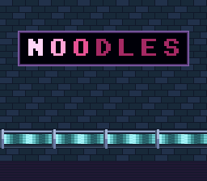

# palette_cycle — animate by rotating CGRAM

**Colour & effects · palette cycling.**

## Why it matters for your game

Flowing water, bubbling lava, crackling fire, a shimmering "loading"
bar, chasing marquee lights — the SNES draws all of these without
redrawing a single pixel or spending any VRAM bandwidth. You rotate a
handful of palette entries and the hardware does the rest. It is the
cheapest animation on the machine, and once you see it you will spot it
in half the games you grew up with.



## What you'll learn

The single new idea: **CGRAM is a live lookup table.** Rewrite one
colour entry during VBlank and every pixel that indexes it changes
colour on the very next frame — no tiles touched, no map redrawn. This
rung rests on what you already know: solid tiles, a tilemap, and
`dmaCopyCGram()` from earlier colour rungs.

The scene is a noodle bar's sign and a coolant pipe on a brick wall
(`res/sign.png`), and it was drawn for the cycle. Each letter of NOODLES is
painted with its own colour index, 8 to 14 of BG palette 0; the coolant
uses indices 8 to 15 of BG palette 1, which follow one another along the
pipe. The wall, the frame and the pipe's metal use the other indices.
Every fourth frame, entries 8-15 of both palettes are rotated by one slot
(each colour moves to the next index) and pushed back to CGRAM: a wave of
light runs along the letters and the coolant flows. Because each wheel
closes the loop (entry 15 flows into entry 8), the cycle is seamless.

That is the whole craft of palette cycling: keep the indices that turn
apart from the ones that stay, and lay them out in the order the light
should run.

## What to observe / if it breaks

- **Correct run:** the letters light up one after another, left to right,
  and the coolant runs along the pipe. Press **START** to freeze the cycle —
  both stop dead, proving the picture itself never moved; press again to
  resume.
- **The wall or the frame changes colour too:** an index that should stay
  is inside the rotated range — keep the static colours out of 8-15.
- **Colours flicker or garble instead of cycling:** the CGRAM reload ran
  outside VBlank. The rotation must happen after `WaitForVBlank()` — the
  CGRAM port is silently ignored during active display.
- **Nothing moves at all:** the frame counter never reaches
  its threshold, or `cycling` got stuck at 0 — check the toggle.

Probe oracle: `cycle_pos` counts every rotation (advances while running,
frozen after a START toggle); `cycling` is the on/off flag.

## Build & run

```bash
make
../../../testing/bin/luna run -n 3000000 palette_cycle.sfc
```

## Assets

`res/sign.png` is drawn by `devtools/art_assets/build.py` (`neon_sign`), with
the library's font scaled three times for the letters; the build converts
it with its two palettes (`colors = 32`: each tile gets the bank of its
colours).

## Modules used

`console`, `dma`, `background`, `input`

## Where you are

← previous: [transparency](../transparency/) · colour math blending
· → next in family: [direct_color](../direct_color/) · the pixel byte *is* the colour
