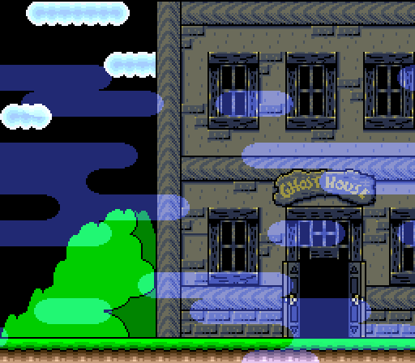
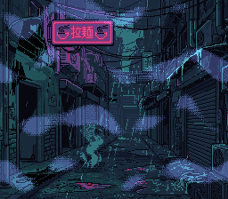
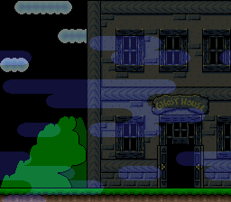

# Color Addition Transparency — and Pseudo-Hires

> Two ways to mix two background layers: additive colour math (the mist
> lightens the street under it), and pseudo-hires (the mist and the
> street interleaved column by column, a 50 % blend with no colour math).





## Controls

| Button | Action |
|--------|--------|
| A | Switch between colour addition and pseudo-hires |

The mist drifts by itself.

## What You'll Learn

- How the SNES color math unit blends layers using CGWSEL and CGADSUB registers
- The difference between main screen and sub screen layer assignment
- How Mode 1 with BG3 priority high creates an overlay layer
- Mixing 4bpp (BG1) and 2bpp (BG3) tile formats in the same mode
- How pseudo-hires (SETINI bit 3) blends the main and sub screens without
  colour math

---

## Build & Run

```bash
cd $OPENSNES_HOME
make -C examples/color/transparency
```

Then open `transparency.sfc` in luna (`luna-gui transparency.sfc`) or any emulator.

## SNES Concepts

### Pseudo-Hires: the Other Blend (A)



```c
colorMathSetLayers(0);      /* no layer in colour math */
videoSetPseudoHires(1);     /* SETINI ($2133) bit 3 */
```

With SETINI bit 3 set, the PPU outputs 512 pixels per line: the sub screen
on the even columns, the main screen on the odd ones (snesdev-wiki, *PPU
registers* and *Uncommon graphics mode games*; anomie's register doc; the
wiki's *Backgrounds* page has the inverse, a known error). A CRT on composite
blends each pair, and so does an emulator's 256-pixel view: the mist sits
half over the street. The colour math is off here — the sub screen reaches
the output only through the interleave — so this blend leaves the colour
math free for something else; the price is horizontal detail, and on a sharp
RGB display the columns show as stripes rather than a blend. The lib keeps a
shadow of the write-only register.

### Color Math: Main Screen + Sub Screen

The SNES PPU can blend two images together using its color math unit. The "main screen"
is the final displayed image. The "sub screen" is a second, hidden rendering of selected
layers whose pixel colors are used as the blend source.

In this example:
- **Main screen**: BG1 (street) + BG3 (mist) -- both visible
- **Sub screen**: BG3 (mist) -- provides the color values for blending

The color math unit takes each main screen pixel and **adds** the corresponding sub
screen pixel color to it. Where the mist overlaps the street, its colour brightens
the street beneath it. Where there are no mist pixels, no addition occurs.

### Mode 1 with BG3 Priority High

Mode 1 normally draws BG3 (2bpp) behind BG1 (4bpp). Setting `BG3_MODE1_PRIORITY_HIGH`
promotes BG3's high-priority tiles above all other BG layers, which is essential for the
mist overlay to render on top of the street.

```c
setMode(BG_MODE1, BG3_MODE1_PRIORITY_HIGH);
```

### Color Math Configuration

```c
colorMathInit();
colorMathSetSource(COLORMATH_SRC_SUBSCREEN);  /* Blend source = sub screen */
colorMathSetOp(COLORMATH_ADD);                /* Addition (brightens) */
colorMathSetLayers(LAYER_BG1 | COLORMATH_BACKDROP);  /* What gets blended */
```

The `COLORMATH_BACKDROP` flag ensures the mist also blends over empty areas (CGRAM entry 0).

### Loading the graphics

The tiles, tilemaps and palettes come out of the two settings files beside the
pictures (`res/street.png.toml`, `res/mist.png.toml`): the build converts
them with `opensnes-tileset` and links the result in the asset banks, and the
generated `res/*.inc` declare the symbols with their bank carried in the far
pointer, so `dmaCopyVram()` / `dmaCopyCGram()` read them from any bank. All
graphics are loaded during forced blank (screen off) since the total data
exceeds the ~4KB VBlank DMA budget.

---

## Walkthrough

### Setup

1. `consoleInit()` initializes the PPU and NMI handler
2. Force blank (`REG_INIDISP = 0x80`) allows unlimited VRAM write time
3. `loadGraphics()` DMAs all tile/tilemap/palette data to VRAM and CGRAM
4. BG1 tilemap at VRAM `$5000`, tiles at `$0000` (4bpp street: 883 tiles, up to `$372F`)
5. BG3 tilemap at VRAM `$5400`, tiles at `$4000` (2bpp mist)
6. Main screen, sub screen, and color math are configured
7. Screen is turned on

### Main Loop

Each frame, BG3's horizontal scroll is incremented by one pixel. The tilemap wraps
naturally, and the mist is drawn to wrap at 256 pixels (every wave of its
noise has a whole number of periods across the width), so it loops without a seam:

```c
while (1) {
    scrX++;
    bgSetScroll(2, scrX, 0);  /* bg index 2 = BG3 (0-indexed) */
    WaitForVBlank();
}
```

`bgSetScroll()` defers the actual PPU register write to the NMI handler via a dirty-flag
mechanism, ensuring scroll updates happen safely during VBlank.

---

## Modules Used

`console`, `sprite`, `dma`, `background`, `colormath`, `input` (`LIB_MODULES` in the Makefile).

## Files

| File | Purpose |
|------|---------|
| `main.c` | PPU setup, color math configuration, scroll loop |
| `res/*.png.toml` | the import settings of the street (`opensnes-tileset`, 16 colours, palette 1) and the mist (2bpp); the build converts and links them |
| `Makefile` | Build config (no conversion rule: the settings files drive it) |
| `res/street.png` | the rainy street at night, 16 colours; generated for OpenSNES, CC0 (`assets/neo-lumen/`) |
| `res/mist.png` | the mist, 2 colours: procedural wisps, CC0 (`assets/neo-lumen/`) |

## What's Next?

**Window Masking:** [Window Example](../window/) - Triangle-shaped HDMA window

**HDMA Gradient:** [Gradient Colors](../gradient_colors/) - Per-scanline color effects
