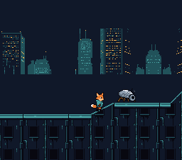

# Map and Objects

A scrolling platformer that combines the **map engine** (tile-based world scrolling)
with the **object engine** (entity management with physics and collision). Kit, the
fox-kit courier, walks over the rooftops of the city at night: flat roofs, ramps he
walks up and down, vents to jump over, and the security machines (robot insects and
patrol automatons) that walk back and forth. This example demonstrates how real SNES
games organize their world and entity logic.



## What You'll Learn

- How to use the map engine for tile-based level scrolling with collision data
- How slope tiles lift a character instead of stopping him (`objCollidMapWithSlopes`)
- How to use the object engine to manage multiple entities with init/update callbacks
- How to implement enemy AI with patrol boundaries and animation
- How to build a multi-file C project on the SNES (separate .c files per entity)
- How the dynamic sprite engine streams sprite tiles into VRAM on demand

## SNES Concepts

### Map Engine and Tile Collision

The SNES PPU renders backgrounds from tilemaps in VRAM, but it has no built-in
concept of "solid ground." The map engine bridges this gap by maintaining a
collision attribute table (`tilesetatt` / `.b16` file) that marks each tile as
solid, passable, hazardous — or a slope. When `objCollidMapWithSlopes()` is
called, it checks the object's position against this table and adjusts velocity
accordingly -- stopping downward movement when standing on a solid tile, for
example. A slope tile (`T_SLOPEU1` … `T_SLOPEUD2` in `map.h`) is not a wall:
walking into one lifts Kit to the surface height for his position inside the
tile. The level has both shapes the engine knows: 45-degree ramps (one tile per
row) and 22.5-degree ramps (two tiles per row, `T_SLOPELU2` then `T_SLOPEUU2`
going up). `objCollidMap()` is the same routine without the slopes; the machines
here patrol flat stretches and need neither. Kit's box is 14 pixels wide from x + 1
(`width = 14`, `xofs = 1`), as in PVSnesLib's slope example: with 16 the box does
not follow a slope correctly (observed; the cause is not traced). The level is 1728
pixels wide (216 tiles of 8); the map engine streams it into a 64x32 tilemap at
VRAM $6800 (`SC_64x32`) as the camera moves.

### Object Engine

The object engine manages a pool of game entities. Each object type registers two
callbacks: an **init** function and an **update** function. These callbacks are
registered from C with `objInitFunctions()`, which takes the callbacks as far
pointers (24-bit: 16-bit address + bank byte), so a type's code may live in any bank.
Each frame, `objUpdateAll()` iterates over all active objects, loads their state
into `objWorkspace`, and calls their update function.

### Dynamic Sprites

Unlike static sprite allocation where tiles live at fixed VRAM addresses, the
dynamic sprite engine (`oamDynamicInit`, `oamDynamicDraw`) uploads only the
tiles that are visible each frame. This is essential when you have multiple animated
characters, since SNES OBJ VRAM is limited to 32 KB. Sprite graphics are stored in
ROM and streamed to VRAM as needed during VBlank — the NMI handler auto-flushes
the VRAM tile queue, so the main loop just calls `oamDynamicDraw(id)` per sprite.
Every character here is a 32x32 frame drawn around a 16x16 collision box, so his
feet are the box's bottom (Kit 8 pixels left and 14 up of it).

## Controls

| Button | Action |
|--------|--------|
| D-Pad Left/Right | Walk |
| A | Jump |
| Up + A | High jump |

## How It Works

### 1. Initialize the Map and Sprite System

The tileset is loaded to VRAM $2000, and the tilemap pointer is set to $6800
with a 64x32 tile layout. The dynamic sprite engine streams 32x32 frames
(`OBJ_SIZE16_L32`) into its large pool at VRAM $0000; it never draws a small
sprite here, so its small pool at $1000 holds the far towers of BG2 instead,
scrolled at a quarter of the camera's speed.

```c
static const OamDynamicConfig dyn_cfg = {
    .vramLarge     = 0x0000,
    .vramSmall     = 0x1000,
    .slotLargeInit = 0,
    .slotSmallInit = 0,
    .sizeMode      = OBJ_SIZE16_L32,
};

bgInitTileSet(0, tiles_tiles, tiles_pal, 0,
              (tiles_tiles_end - tiles_tiles), PALETTE_16_SIZE, BG_16COLORS, 0x2000);
bgSetMapPtr(0, 0x6800, SC_64x32);
oamDynamicInit(&dyn_cfg);
```

### 2. Register the Object Types

Each object type (Kit = 0, robot insect = 1, patrol automaton = 2) registers its
init and update functions; a C function pointer carries its bank, so this is
plain C:

```c
objInitFunctions(0, kitinit,       kitupdate,       0);
objInitFunctions(1, insectinit,    insectupdate,    0);
objInitFunctions(2, automatoninit, automatonupdate, 0);
```

### 3. Load Objects from Map Data

The objects are stored in a `.o16` file (x, y, type, patrol x min, patrol x max per
object). The object engine parses it, calling each type's init function to spawn
entities at their map positions:

```c
objLoadObjects((u8 *)&objlevel);
mapLoad((u8 *)&maplevel, (u8 *)&tilesetdef, (u8 *)&tilesetatt);
```

### 4. Main Loop: Update, Draw, Sync

Every frame: update the map scroll state, update all objects (physics + AI),
wait for VBlank, then let `mapVblank()` flush tilemap changes. The NMI
handler auto-flushes the dynamic sprite engine.

```c
while (1) {
    mapUpdate();
    objUpdateAll();
    bgSetScroll(1, mapGetCameraX() >> 2, 0);   /* the far towers */
    WaitForVBlank();
    mapVblank();
}
```

### 5. Enemy AI (the robot insect)

Each machine patrols between its `xmin` and `xmax`, turning at each end (its sheet
faces right, so it is mirrored walking left), and steps through four walk frames,
one every 6 frames. Screen position is computed by subtracting the camera scroll
(`mapGetCameraX()`, `mapGetCameraY()`):

```c
insectx = insectx - mapGetCameraX();
oambuffer[insectnum].oamx = insectx + INSECT_DRAW_DX;
oamDynamicDraw(insectnum);
```

The two machines share one palette, OBJ palette 1 (`OBJ_PAL(1)`); Kit has palette 0.

## The Level

`devtools/art_assets/build.py` writes the level from the art in `assets/neo-lumen/`
(generated for OpenSNES, CC0): the roof's neon strip and the wall of windows are
sampled from a generated rooftop, the six slope shapes and the vents are drawn by
the script, and the map is laid out from a list of flats, ramps and vents. It
writes `res/tiles.png`, `res/BG1.m16`, `res/level.t16` (each tile's VRAM tile),
`res/level.b16` (each tile's `T_SOLID`, `T_SLOPE*` or empty) and `res/level.o16`.
`testing/manifests/playthrough_mapandobjects.toml` walks the whole level with four
jumps.

## Project Structure

```
mapandobjects/
├── main.c             — Initialization, main loop, map/object engine setup
├── kit.c / .h         — Kit: input, physics, slopes, walk/jump/fall animation
├── insect.c / .h      — The robot insect: patrol AI, 4-frame walk
├── automaton.c / .h   — The patrol automaton: the same patrol, slower, taller
├── res/*.png.toml     — import settings of the tileset, the skyline and the three
│                       sprite sheets; the build converts and links them
├── data.asm           — ROM data no tool converts: the level (.m16/.o16/.t16/.b16)
├── Makefile           — Build config (4 C files, 9 library modules)
└── res/               — Tileset, sprite sheets, level data (.m16/.o16/.t16/.b16)
```

## Build & Run

```bash
cd $OPENSNES_HOME
make -C examples/demos/mapandobjects
```

Then open `mapandobjects.sfc` in luna (`luna-gui mapandobjects.sfc`) or any
emulator. Walk right: jump the first vent with A, then walk up the ramp to the
first robot insect.

## Modules Used

`console`, `sprite`, `sprite_dynamic`, `sprite_lut`, `dma`, `input`, `background`, `map`, `object` (`LIB_MODULES` in the Makefile).
