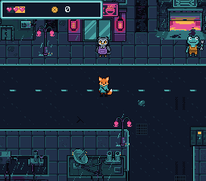

# rpg — an RPG template driven by a Tiled map



The SDK's modules composed into a playable RPG skeleton. Kit the courier
walks the Rue basse at night, between a noodle bar, a garage, a junk shop
and a canal; the residents each have a line, a locker holds ten credits,
and the teal door of an apartment block leads into the raccoon's den.
Three things make it a *template* rather than a demo:

**1. The map is a real Tiled map.** `res/town.tmj` holds the terrain,
the per-tile collision (each tile's `attribute` property), the entity
positions (the `Entities` object layer: spawn, residents, the lockers, the
door) *and* each resident's line and look (`text` and `look` properties on
the object). Adding a resident is a map edit, not a code edit. The build
converts the map with the SDK's `opensnes-level` (`res/town.tmj.toml`): the
VRAM tilemap, one collision byte per cell, and the entities as C defines.

**2. A real bordered dialog box, and a HUD.** Both are 9-slice panels
on BG2 with their text on BG3 above — the classic SNES RPG window, with
the layers stacking scene < panel < text. The HUD carries hearts and
credits; the credits go up by 10 when you open the lockers.

**3. Two scenes.** The street, and the den. A scene is a tileset + a
palette + a tilemap + a collision map + entities, and the den is its own
Tiled map (`res/house.tmj`). Walking into the door swaps them; the
raccoon greets you with no button press.

| Input | Action |
|---|---|
| D-pad | walk (one metatile, 16 px, per step) |
| A | talk to a resident (face it) / open the lockers (face them) |
| walk into the teal door | enter the den; the mat inside takes you back |

ROM mode: LoROM (project default).

## SNES Concepts

- **Tiled as the content pipeline**: collision and entities are data.
  `opensnes-level` reads `town.tmj` and writes `street.q16` (the 64×64
  tilemap in the PPU's four 32×32 pages), `street.c16` (a collision byte
  per cell, what `collideTile()` reads) and `town_entities.inc`. The
  residents' table, `NPC_TABLE`, takes its fields from the objects'
  properties: `u8 tx; u8 ty; const char *text; u16 look;`.
- **Metatile movement**: the map is 8×8 cells, the world is walked on a
  grid of 16×16 metatiles. A character *occupies one metatile*; its 32×32
  sprite is drawn over it, feet on it and head overhanging upward (8 px
  left and 16 px up of the metatile) — the standard top-down convention. A
  step asks `collideTile()` about the metatile's four cells, and is refused
  where a resident stands.
- **A 32×32 sprite is a 4×4 block of the OBJ name table**, which is 16 tiles
  wide. Kit's walk is one sheet of 15 frames, four to a 128-px row, so it
  goes to VRAM in one DMA; each resident is a frame converted on its own,
  which the converter writes as four rows of 16 tiles with the frame in the
  first four of each, so `load_resident()` copies it in four DMAs of 128
  bytes, one name-table row apart. The residents live in the second name
  table (tiles 256 and up, word `$7000`).
- **The plan owns the sprite-palette slots**: `res/palettes.toml` lists
  the OBJ palettes, one per character; the build runs `opensnes-palette
  plan` (see `docs/tools/opensnes-palette.md`) to assign each a
  collision-free CGRAM slot and generate `res/palettes.inc`. `main.c` uses
  `PAL_OWL_CGRAM` / `PAL_OWL_SLOT` and so on, so adding a resident never
  desyncs the code from the layout — no hand-counted `128` / `144`. The BG
  palettes stay hand-managed on purpose: the two scenes *swap* the same
  slot 0 and the text layer owns slot 1 at runtime, a dynamic layout a
  static plan does not model.
- **Off-camera entities must be hidden, not just drawn**: OAM X is 9
  bits and Y is 8, so an entity outside the camera does not vanish —
  its coordinates *wrap* and it reappears somewhere plausible, e.g. a
  resident standing inside a wall. `draw_char()` parks anything
  off-camera with `oamHide()`.
- **Forced blank, not brightness 0, around a big VRAM upload**:
  `setScreenOff()` sets INIDISP bit 7, the only state besides VBlank in
  which the PPU accepts VRAM writes. `setBrightness(0)` just makes the
  screen black — the PPU keeps fetching and the write is dropped. A scene
  switch moves 37 KB (the street's 939 tiles, its 8 KB map, a palette).
- **A fixed 16-colour palette per scene**, imposed on the converter
  (`palette = "town_fixed.pal"` in `res/tileset.png.toml`) instead of
  quantised from the picture. With a quantiser, adding one tile re-derives
  the whole palette and every existing tile shifts hue. Both scenes are
  drawn in the city's 15 colours, so the two fixed palettes are the same.
- **Two 9-slice panels on one layer** via the `panel` module: the HUD at
  the top and the dialog box at the bottom share BG2's tilemap, so one
  upload covers both and opening a dialog never disturbs the HUD. BG2
  shares BG3's character base: an empty cell of a panel is tile 0, so the
  first 16 words there are kept zero and the font starts after them.
  `panelPut()` takes an absolute tile, the sheet's index plus its base.
- **Collision through the SDK's `collideTile()`** over the converted map.
  Its `tilemap` parameter is `const`, so the lookup is a bank-honouring far
  read — the 4 KB maps need neither bank $00 nor a byte of RAM.

## VRAM Layout

| Word address | Content |
|---|---|
| `$0000` | the scene's tiles (939 for the street, to `$3AB0`; 470 for the den) |
| `$4000` | BG1's map, 64×64 |
| `$5000` | BG2's and BG3's character base: a blank tile, then the font |
| `$5400` | BG2's tiles: the frame and the HUD icons (tile 64 from the base) |
| `$5800` | BG3's map (the text) |
| `$5C00` | BG2's map (the panels) |
| `$6000` | Kit's walk (OBJ tiles 0-239) |
| `$7000` | the residents (OBJ tiles 256 and up) |

## Editing the map

Open `res/town.tmj` in [Tiled](https://www.mapeditor.org/): paint terrain
with the tileset's tiles, drag the `Entities` objects, edit a resident's
`text` or `look`, then `make`. Tile collision is the `attribute` property
on each tileset tile (`FF00` = solid, `0` = walkable). Entities are
objects in the `Entities` layer, typed `spawn`, `npc`, `locker` or `door`
(the den's are `arrival`, `host` and `mat`). A resident's `look` indexes
`looks[]` in `main.c`: 0 the owl, 1 the frog, 2 the rat, 3 the pangolin,
4 the raccoon.

The street itself is composed by `devtools/art_assets/rpg.py`
(contributors). The ground is laid on the metatile grid from PixelLab's
tiles (`assets/neo-lumen/tiles/`): two Wang sets, road to sidewalk and canal
to sidewalk, placed by the terrain at each metatile's corners, so the curbs
and the quays follow the layout; variants of the full tiles (cracks, a
puddle, a grate) drawn from a seeded generator so every build is the same;
the street's centre line, the bridge deck with its railings, the alleys.
The buildings and props of `assets/neo-lumen/town/` are placed over it, and
the whole is cut into its distinct 8×8 tiles — 32 to a row of the tileset,
the width the tileset converter's map is written in. Running it again
rewrites both maps from its layout.

## Assets

| File | What | Made by |
|---|---|---|
| `res/tileset.png`, `res/town.tmj` | the street's 939 tiles and its map, entities included | `devtools/art_assets/rpg.py`, from `assets/neo-lumen/town/` and `assets/neo-lumen/tiles/` (PixelLab) |
| `res/interior.png`, `res/house.tmj` | the den's tiles and map | the same, from `assets/neo-lumen/backgrounds/den.png` (PixelLab) |
| `res/town_fixed.pal`, `res/interior_fixed.pal` | the city's 15 colours, imposed on both | the same |
| `res/hero.png` | Kit's walk, 15 frames of 32×32 | the same, from `characters/topdown/kit_walk_sheet.png` |
| `res/owl.png` … `res/raccoon.png` | the five residents from above, one 32×32 frame each | the same, from `characters/topdown/` |
| `res/uibox.png` | the 9-slice frame, two hearts and a credit chip | the same, drawn there |

CC0, like the rest of the Néo-Lumen assets (`assets/neo-lumen/README.md`).

## How to Build

```bash
make
```

## Modules Used

console, dma, background, sprite, text, input, collision, panel
