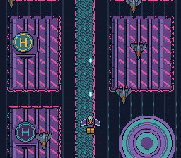

# shmup

A vertical shoot 'em up: Kit's delivery glider over the city at night,
against the security's hunters. The city scrolls down on BG1 and wraps every
512 lines; the glider, a pool of hunters and Kit's shots are sprites, and a
shot that meets a hunter takes both out.



## Controls

| Input | Action |
|---|---|
| D-pad | move the glider |
| A | fire (a short cooldown between two shots) |

## SNES Concepts

- **Vertical auto-scroll** of a 256×512 scene (`SC_32x64`) with `bgSetScroll`
- **Sprite pools**: fixed-size arrays of `{x, y, active}` slots; the glider
  has OAM slot 0, the hunters 1-8, the shots 9-16
- **Several sprite types in one OAM grid**: distinct VRAM regions and
  distinct sprite palettes (0, 1, 2)
- **AABB overlap test** between 32×32 sprites
- **One picture, two directions**: the hunter is drawn nose up, like the
  glider; its OAM attribute's vertical flip turns it to dive
- **Edge-triggered fire** with `padPressed()`

A shot despawns once its visible pixels leave the top of the screen
(`y < -12`), not when its 32×32 frame does: past that point the 8-bit OAM
`y` wraps and the shot would flash at the bottom for a frame.

## Architecture

```
VRAM (BYTE / WORD addresses)
  $0000 / $0000  BG1 tilemap          (SC_32x64, 4 KB)
  $4000 / $2000  BG1 tiles            (184 unique 8×8)
  $C000 / $6000  Sprite tiles         (glider + hunter + shot)

CGRAM
   0-15  BG1 palette 0 (the city)
 128-143 sprite palette 0 (the glider)
 144-159 sprite palette 1 (the hunter)
 160-175 sprite palette 2 (the shot)

OAM
   0       the glider
   1..8    hunter pool
   9..16   shot pool

setMode(BG_MODE1, 0);
setMainScreen(TM_BG1 | TM_OBJ);
```

## Build

```bash
cd examples/demos/shmup && make
```

Produces `shmup.sfc` (LoROM, 256 KB).

## Assets

| File | What | Made by |
|---|---|---|
| `res/scene.png` | the city from the sky, 256x512, wrapping vertically: two blocks of roofs either side of a canal, the round plaza, helipads | `devtools/art_assets/shmup.py`: the Mode 7 city's Wang tiles (PixelLab) laid out on a strip, pieces of `backgrounds/aerial.png` stamped on it |
| `res/player.png` | Kit's delivery glider from above | `characters/glider.png` (PixelLab), indexed |
| `res/enemy.png` | the security's hunter from above, nose up | `characters/hunter.png` (PixelLab), indexed |
| `res/bullet.png` | Kit's shot, an aqua bolt in the middle of 16x16 | `devtools/art_assets/shmup.py`, drawn there |

`python3 devtools/art_assets/build.py` writes the four again (contributors).

## Modules Used

`console`, `dma`, `background`, `asset`, `sprite`, `input`.

## Licence

CC0, like the rest of the Néo-Lumen assets (`assets/neo-lumen/README.md`).
