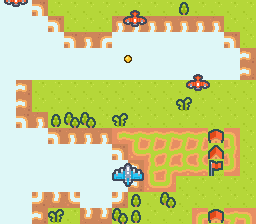

# shmup_1942

A vertical "1942-style" shoot 'em up on Kenney's CC0 *Pixel Shmup* pack: a
terrain that scrolls down on BG1, the player's plane, a pool of enemies and
the player's bullets as sprites, and the collision between bullets and
enemies.



## Controls

| Input | Action |
|---|---|
| D-pad | move the plane |
| A | fire (a short cooldown between two shots) |

## SNES Concepts

- **Vertical auto-scroll** of a 256×512 scene (`SC_32x64`) with `bgSetScroll`
- **Sprite pools**: fixed-size arrays of `{x, y, active}` slots; the player
  has OAM slot 0, the enemies 1-8, the bullets 9-16
- **Several sprite types in one OAM grid**: distinct VRAM regions and
  distinct sprite palettes (0, 1, 2)
- **AABB overlap test** between 32×32 sprites
- **Edge-triggered fire** with `padPressed()`

A bullet despawns once its visible pixels leave the top of the screen
(`y < -12`), not when its 32×32 frame does: past that point the 8-bit OAM
`y` wraps and the bullet would flash at the bottom for a frame.

## Architecture

```
VRAM (BYTE / WORD addresses)
  $0000 / $0000  BG1 tilemap          (SC_32x64, 4 KB)
  $4000 / $2000  BG1 tiles            (49 unique 8×8)
  $C000 / $6000  Sprite tiles         (player + enemy + bullet)

CGRAM
   0-15  BG1 palette 0 (terrain)
 128-143 sprite palette 0 (player)
 144-159 sprite palette 1 (enemy)
 160-175 sprite palette 2 (bullet)

OAM
   0       player
   1..8    enemy pool
   9..16   bullet pool

setMode(BG_MODE1, 0);
setMainScreen(TM_BG1 | TM_OBJ);
```

## Build

```bash
cd examples/demos/shmup_1942 && make
```

Produces `shmup_1942.sfc` (LoROM, 256 KB).

## Re-generating assets

```bash
python3 res/extract_sprites.py   # re-extract player + enemy + draw bullet
python3 res/compose_scene.py     # redraw the terrain (bump SEED)
make
```

## Modules Used

`console`, `dma`, `background`, `asset`, `sprite`, `input`.

## Licence

Source artwork: CC0 from [Kenney](https://kenney.nl/assets/pixel-shmup).
See [ATTRIBUTION.md](https://github.com/k0b3n4irb/opensnes/blob/develop/ATTRIBUTION.md).
