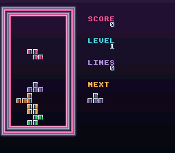

# Blocks

A falling-blocks puzzle in the Arcade of the Rue basse: data containers fall
into a neon cabinet's well, to Korobeiniki (the 19th-century Russian song,
public domain, arranged for OpenSNES).

## Features

- 7 standard pieces (I, O, T, S, Z, J, L)
- DAS (Delayed Auto Shift) for smooth horizontal movement
- Line clear animation with screen shake
- Multi-line clear (single, double, triple, four lines)
- NES-style gravity speed table (30 levels)
- Score, level, and lines counter
- Next piece preview
- HDMA gradient background
- Korobeiniki music via SNESMOD
- Random piece order (seeded from frame count)

## Controls

| Button | Action |
|--------|--------|
| LEFT/RIGHT | Move piece |
| DOWN | Soft drop |
| A | Rotate clockwise |
| B | Rotate counter-clockwise |
| START | Start game / Pause |

## Architecture

- **BG1** (4bpp): Playfield — border + locked blocks + falling piece
- **BG2** (4bpp): HUD — score, level, lines, next piece preview
- **BG3** (2bpp): Message overlay (PRESS START, PAUSED, GAME OVER)
- **HDMA**: Background color gradient, the arcade's violet night down to black
- **SNESMOD**: Korobeiniki theme music

## Assets

| File | What | Made by |
|---|---|---|
| `res/tiles.png` | 4bpp sheet: the seven containers, the ghost, the cabinet's frame, the font at its ASCII codes (`res/tiles.png.toml`) | `devtools/art_assets/blocks.py` |
| `res/font2bpp.bin` | BG3's 2bpp font, the same glyphs with a shadow | `devtools/art_assets/blocks.py` |
| `music/blocks_theme.it` | Korobeiniki | `devtools/audio_assets/` |

The palettes are in `data.asm` (the cabinet, the HUD labels) and `main.c`
(the messages' colour cycle). CC0, like the rest of the Néo-Lumen assets
(`assets/neo-lumen/README.md`).

## Modules

`console sprite dma background input hdma` + `USE_SNESMOD := 1`
