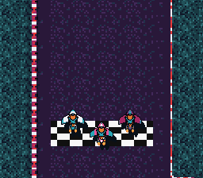

# mode7_racing — an F-Zero-style mini game



A hover-bike race on a circuit laid over the city's rooftops, round a
lagoon. Kit's bike stays fixed low on screen and the **world** rotates and
scrolls under it — the classic SNES racing camera, driven per frame by the
mode7 module (`mode7SetAngle` + `SetCenter` + `SetScroll`). Two rivals
leave the line with Kit and ride their lanes; seen from the turning camera,
their bikes turn with it.

| Input | Action |
|---|---|
| D-pad left/right | steer |
| A | accelerate |
| B | brake |

The gravel slows the bike to a crawl; the lagoon, its quay and the rooftop
props (helipads, air conditioners, tanks, solar panels, dishes) stop it;
the two chevron pads, on the right and the bottom straight, throw it
forward at 5 px a frame.

ROM mode: LoROM (project default).

## SNES Concepts

- The F-Zero camera: `mode7SetCenter(bike)` pivots rotation on the
  bike, `SetScroll` places it low on screen, `SetAngle(heading)` spins
  the world — heading shares the math module's 0-255 angle unit, so
  it feeds `fixSin`/`fixCos` (velocity) and the PPU matrix directly
- Sprites on a turning Mode 7 plane: the plane shows
  `world = bike + M (screen - pivot)`, so a rival's world position reaches
  the screen through the inverse matrix, `2 (cos, sin / -sin, cos)` at the
  scale 0x0080 used here (`to_screen()` in `main.c`)
- A sprite cannot rotate, so each rival's bike is drawn turned five times,
  0 to 90 degrees; the H and V flips of OAM give the other twelve of the
  sixteen directions
- Fixed-point driving physics: 12.4 positions, 8.8 speeds,
  surface-dependent speed caps
- A 16 KB collision class map read from C as a const array: it sits in an
  asset bank like any const data, and C reads it with its bank
- Mode 7 VRAM interleave (`dmaCopyVramMode7`) + OBJ tiles at name base 3;
  between sprites the lower OAM index is in front, so the bikes are
  sprites 0-2 and their shadows 3-5

## The art

`devtools/art_assets/build.py` writes `res/` from the CC0 art of
`assets/neo-lumen/` (`racing.py`):

- the circuit, 1024x1024 in 227 of Mode 7's 256 tiles, from two PixelLab
  Wang tilesets placed by the corners of a 16-px vertex grid: asphalt and
  gravel with a red and white curb, gravel and water with a quay;
- the rooftop props, 32x32 from PixelLab, on the 16-px grid so that each
  costs its tiles once; the start line and the boost pads drawn by the
  script;
- `track_class.bin`, the class of each 8x8 tile, and the rivals' lanes
  (`lanes_xy.bin`, `lanes_heading.bin`), 256 points either side of the
  centre line;
- the bikes, 32x32 from PixelLab in one palette, the rivals' turned with
  RotSprite (Scale2x three times, turn, back by the commonest colour).

## How to Build

```bash
make
```

## Modules Used

console, dma, background, sprite, math, mode7, input
