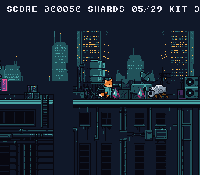

# rooftop_run — Kit's Rooftop Run

> A complete side-scrolling platformer: Kit, the fox-kit courier, runs over the
> rooftops of the city at night to the radio beacon at the end of the level,
> picking up data shards and stomping the security machines on the way. Title
> screen, score, three lives, checkpoints, a game over and a roof cleared — with
> gravity, tile collision, and a camera that follows him across a world bigger
> than the screen.



## Controls

| Button | Action |
|--------|--------|
| START | Start the run (title), back to the title (game over, roof cleared) |
| D-Pad Left/Right | Walk |
| A | Jump (hold Up + A for higher jump) |

## The Game

- **Data shards** (29) spin over the roofs and at the top of every jump: 10
  points each.
- **Robot insects** walk on four roofs, **drones** fly over two: land on one to
  flatten it (100 points, and Kit bounces); touch one from the side and Kit
  loses a life.
- A **fall** between two roofs costs a life too. Kit comes back at the start of
  the last roof he stood on, and blinks for a moment while nothing can hurt him.
- **Three lives**; with none left, the game is over.
- The **beacon** at the end clears the roof: 500 points for each life left.

## What You'll Learn

- How tile streaming works — loading new map columns into VRAM as the camera scrolls
- Fixed-point physics: gravity, acceleration, and sub-pixel movement on a CPU with no multiply
- Tile-based collision detection with O(1) lookups (no sprite-to-sprite checks)
- The double-buffer pattern: stage data in RAM during active display, flush to VRAM during VBlank
- Why the camera position and the scroll register are two different things
- How a dynamic sprite keeps its VRAM slot (draw every sprite, every frame, in one order)
- How static sprites live beside the dynamic engine in the same OAM
- Sprite-to-sprite collision: a stomp from above or a hit from the side
- A text HUD on BG3, in front of the two other layers
- A game state machine: title, play, a life lost, game over, cleared

---

## Build & Run

```bash
cd $OPENSNES_HOME
make -C examples/games/rooftop_run
```

Then open `rooftop_run.sfc` in luna (`luna-gui rooftop_run.sfc`) or any emulator.

## Walkthrough

### 1. The World Is Bigger Than the Screen

The SNES screen is 256 pixels wide — 32 tiles. But the rooftop level is 2352 pixels,
294 tiles wide. The PPU's tilemap is only 32x32 entries, so you can't load the entire world
at once. Instead, the game streams new tile columns into VRAM as the camera scrolls.

Think of the tilemap as a circular buffer. As the camera moves right, the leftmost
column scrolls off-screen. That column's VRAM slot gets overwritten with the next
column from the map. The player never sees the swap because it happens off-screen.

### 2. The VRAM Layout

```c
#define VRAM_SPR_LARGE  0x0000   // Kit's and the machines' 32x32 frames (the dynamic engine's pool)
#define VRAM_SHARD      0x0C00   // The shard's eight frames, in the pool's last slots
#define VRAM_BG2_TILES  0x1000   // The skyline's tiles (the engine's small pool, unused here)
#define VRAM_BG_TILES   0x2000   // The level's 831 tiles, up to $53F0
#define VRAM_BG3_TILES  0x6000   // The HUD's font (2bpp)
#define VRAM_BG_MAP     0x6800   // BG1 tilemap (64x32)
#define VRAM_BG2_MAP    0x7000   // BG2 tilemap (64x32)
#define VRAM_BG3_MAP    0x7800   // BG3 tilemap, the HUD (32x32)
```

The level's tileset (the pixel art for every unique tile) lives at `$2000`, its
tilemap (which tile goes where) at `$6800`. Kit's frames are streamed to `$0000`.
The dynamic sprite engine keeps a second pool at `$1000` for small sprites; this game
draws none, so the far skyline of BG2 takes the room (155 tiles: its two halves are
mirrors, and the converter's `flip` stores the second as flip bits).

### 3. Streaming: The Column Pipeline

Streaming happens in three stages, split across the frame:

**During active display** (CPU is free, PPU is drawing):
```c
static void map_prepare_column(u16 map_col, u16 vram_col) {
    /* Fill col_buffer[32] from map data — RAM only, no VRAM access */
    for (row = 0; row < map_height; row++) {
        col_buffer[row] = map_row_ptrs[row][map_col];
    }
    /* Note the transfer: 64 bytes, the address stepping by 32 words
     * (down the column) */
    vramQueuePush((const u8 *)col_buffer, vram_addr, 64, VRAM_QUEUE_COLUMN);
}
```

**During VBlank** (PPU is idle, VRAM is writable), `vramQueueFlush()` sends
what was noted, one DMA per entry (the `vramqueue` module).

**The decision logic** (every frame):
```c
static void map_update(void) {
    tile_x = camera_x >> 3;
    if (tile_x != last_tile_x) {
        /* Camera moved — stream the column 32 tiles ahead */
        new_col = tile_x + 32;
        map_prepare_column(new_col, new_col & 31);
        last_tile_x = tile_x;
    }
}
```

> **Why +32, not +31?** The screen shows tiles 0-31, but tile 32 is partially visible
> at the right edge (the camera rarely sits on an exact tile boundary). Without that
> extra column, you'd see a blank strip flickering at the right side during scrolling.
> This was a bug in the original port that took a while to track down.

### 4. The Level and the Skyline

The level is a row of buildings, each made of one to three roof pieces of 128x128
pixels at one height, with gaps between them. `devtools/art_assets/build.py` lays it
out from the generated pieces in `assets/neo-lumen/tiles/` and writes the four files
this example reads: `res/tiles.png` (the 831 distinct 8x8 tiles, in the order the map
numbers them), `res/BG1.m16` (the map), `res/map_1_1.b16` (solid or empty, per tile)
and `res/skyline.png`. A roof's walkable surface is the top of its neon strip, so a
tile is solid when it sits at the surface's row or below; the script refuses a tile
that would be solid in one place and empty in another. Each step up is at most 16
pixels and each gap at most 24, so the normal jump crosses them all
(`testing/manifests/playthrough_rooftop_run.toml` plays the level to its end).
The same script stamps the radio beacon (`assets/neo-lumen/props/beacon.png`)
on the last roof and writes `res/level_objects.h`: where the shards, the
machines and the checkpoints are, read from the same list of buildings, so
a change to the level moves them with it.

BG2 is the band of far towers, scrolled at a quarter of the camera's speed:

```c
bgSetScroll(1, camera_x >> 2, 0);   /* the far towers: a quarter of the speed */
```

### 5. Fixed-Point Physics

The 65816 has no multiply instruction and runs at 3.58 MHz. You can't afford
floating-point anything. Instead, positions and velocities use **8-bit fixed-point**:
the high byte is the pixel position, the low byte is the fractional part (1/256th
of a pixel).

```c
static s16 kit_xvel;     /* Velocity: units of 1/256 pixel per frame */
static u8  kit_xfrac;    /* Fractional pixel accumulator */

/* Apply velocity */
new_frac = (s16)kit_xfrac + kit_xvel;
kit_x += asr8(new_frac);     /* Integer part → pixel position */
kit_xfrac = new_frac & 0xFF; /* Fractional part → carry forward */
```

At 60fps, a velocity of `0x0140` (= 1.25 pixels/frame) moves Kit at 75 pixels per
second. The fractional accumulator means Kit can move at speeds finer than 1 pixel
per frame — essential for smooth deceleration.

> **What's `asr8()`?** Arithmetic shift right by 8 — dividing by 256 while
> preserving the sign, written out with an unsigned shift and two inversions so
> the intent is visible. cc65816's `>>` on a signed value IS arithmetic (the
> compiler checks pin it: `devtools/compiler-tests/cases/test_signed_ops.c`), so
> `val >> 8` would do the same; the helper is readability, not a workaround.

### 6. Gravity in Two Lines

```c
kit_yvel += GRAVITY;                /* Accelerate downward every frame */
if (kit_yvel > 0x0400) kit_yvel = 0x0400;  /* Terminal velocity */
```

`GRAVITY = 48` (in 1/256 pixel/frame units). That's roughly 0.19 pixels/frame of
acceleration — these constants come from the PVSnesLib example this one began as,
and they feel right for a platformer.

Jumping sets a negative Y velocity:
```c
if (padPressed(0) & KEY_A) {
    if (padHeld(0) & KEY_UP)
        kit_yvel = -KIT_HIJUMPING;  /* -0x0594: high jump */
    else
        kit_yvel = -KIT_JUMPING;    /* -0x0394: normal jump */
}
```

### 7. Tile-Based Collision

No bounding boxes, no sprite lists. The world is made of tiles, and collision is a
lookup:

```c
static u8 map_get_tile_prop(s16 px, s16 py) {
    tx = px >> 3;
    ty = py >> 3;
    if (tx < 0 || ty < 0 || tx >= map_width || ty >= map_height)
        return T_SOLID;  /* Out of bounds = wall */
    tile_id = map_row_ptrs[ty][tx] & 0x03FF;  /* Mask off flip/palette bits */
    return tile_props[tile_id];
}
```

`map_row_ptrs[]` is precomputed at load time — one pointer per row, so looking up a
tile is just an array index. No multiplication, no searching. O(1).

To check if Kit is standing on ground, test two points at his feet:

```c
left  = map_get_tile_prop(kit_x + 2,  kit_y + 16);
right = map_get_tile_prop(kit_x + 13, kit_y + 16);
if (left == T_SOLID || right == T_SOLID) {
    kit_y = ((kit_y + 16) & 0xFFF8) - 16;  /* Snap to tile grid */
    kit_yvel = 0;
    kit_action = ACT_STAND;
}
```

Two points, not one, because the collision box is 16 pixels wide. Testing only the
center would let Kit hang off ledges with half his body in mid-air. The box is
smaller than his 32x32 frame: the sprite is drawn 8 pixels left and 14 up of it
(`KIT_DRAW_DX`, `KIT_DRAW_DY`), so his feet, on row 30 of the frame, are the box's
bottom.

### 8. Sprites: Dynamic Slots and Static Shards

Kit and the six machines are **dynamic sprites**: `oamDynamicDraw()` gives each
sprite drawn a 32x32 slot of VRAM, in the order they are drawn, and uploads a
frame's tiles only when it changes (`oamrefresh`). If a machine were skipped
when off screen, every sprite drawn after it would land in another slot,
over tiles that are someone else's. So all of them are drawn every frame, in
the same order — a machine off screen or stomped is drawn hidden — and each one
keeps its slot. A machine changes frame only while it is seen, which keeps the
uploads to the ones on screen.

A hidden 32x32 sprite is drawn at y = 224, below the 224 visible lines, not at
`OBJ_HIDE_Y` (240): sprites wrap at line 256, and a 32-px one at 240 shows its
bottom 16 rows at the top of the screen. (`oamHide()` sets the ninth x bit as
well, so it hides any size; the dynamic engine draws from `oamx`/`oamy` as given.)

The 29 **shards** are plain 16x16 sprites (`oamSet`, OAM entries 32 and up).
Their eight frames are loaded once, in the tiles of the engine's slots 12-15,
which it never reaches with seven sprites; the engine hides only the entries it
drew the frame before, so it leaves them alone.

### 9. Meeting the Machines

Kit, a shard and a machine each have a 16x16 box, and two boxes touch when
their corners are less than 16 pixels apart on both axes (shrunk a little, so
a brush is not a hit). Against a machine, the question is where Kit comes from:

```c
if (kit_yvel > 0 && kit_y + 16 <= y + 8) {   /* falling, feet in its top half: a stomp */
    en_state[i] = EN_FLAT;
    kit_yvel = -KIT_BOUNCE;
    score += 10;                             /* 100 points: the score is kept in tens */
} else if (!kit_safe) {
    lose_life();
}
```

### 10. The HUD and the States

The score, the shards and the lives are text on **BG3**, Mode 1's 2bpp layer,
in front of the level because of two priority bits: `BG3_MODE1_PRIORITY_HIGH`
in `setMode()`, and the priority bit of each text tile (`text_config.priority`).
The text module sends its whole map (2 KB) in the VBlank after `textFlush()`,
so the HUD is printed only when a number changes. Its palette is BG3's palette
5, CGRAM 21-23, three colours the skyline's palette leaves unused.

The game is a small state machine — `GS_TITLE`, `GS_PLAY`, `GS_DOWN` (a life
lost: the world waits a second), `GS_OVER`, `GS_CLEAR`. When the camera jumps
(back at a checkpoint, a new run), the 33 columns it now shows are written at
once with the screen off, and the loop turns it back on after the next VBlank,
once the NMI has sent the sprites' tiles.

### 11. The Main Loop

One frame, one iteration. Game logic runs during active display, VRAM writes during VBlank:

```c
while (1) {
    switch (game_state) { ... }          /* the title, the run, a life lost, the end */
    kit_animate();
    kit_update_camera();                 /* Kit, dynamic slot 0 */
    enemies_update(move, meet);          /* the machines, slots 1-6 */
    shards_update(take);                 /* the shards, static OAM 32 and up */
    map_update();                        /* Stage column in RAM */

    /* VBlank — hardware updates */
    WaitForVBlank();
    vramQueueFlush();                    /* Send the staged column to VRAM */
    bgSetScroll(0, camera_x, 0);        /* Update scroll register */
    /* NMI handler auto-flushes the dynamic sprite engine
     * (end-frame + VRAM tile queue) and the text, when asked */
    snesmodProcess();
}
```

The split is strict: everything above `WaitForVBlank()` touches only RAM.
Everything below it writes to hardware. Break this rule and you get visual corruption.

---

## Tips & Tricks

- **Kit falls through the floor?** Check your collision points. If `kit_y + 16`
  overshoots by even one pixel, the tile lookup returns the row below the floor — empty
  space — and Kit keeps falling.

- **Tiles missing at the right edge?** Your streaming offset is wrong. It must be
  `tile_x + 32`, not `tile_x + 31`. The 33rd tile is partially visible.

- **Kit slides after stopping?** That's intentional — deceleration. The velocity
  decreases by a fixed amount each frame until it reaches zero. Remove the deceleration
  code and Kit stops instantly (feels stiff).

- **Scrolling tears or flickers?** `bgSetScroll()` must happen during VBlank. If it's
  called during active display, the top and bottom halves of the screen scroll by
  different amounts for one frame.

---

## Go Further

- **A second level:** `LEVEL` in `devtools/art_assets/build.py` is a list of
  buildings; the shards, the machines and the checkpoints follow it. Write a
  second list, a second map, and load it after the beacon.
- **A boss:** a third machine type in `enemy_def` that takes three stomps.
- **Study the physics:** Change `GRAVITY`, `KIT_ACCEL`, and `KIT_JUMPING`. Small
  tweaks completely change how the game feels. This is how real platformers are tuned.

---

## Under the Hood: The Build

### The Makefile

```makefile
TARGET      := rooftop_run.sfc
CSRC        := main.c
ASMSRC      := data.asm
USE_LIB     := 1
LIB_MODULES := console sprite sprite_dynamic sprite_lut dma input background anim vramqueue text
```

### Asset Conversion

The Makefile has no conversion rule: each picture carries its import settings
in a file beside it, and the build runs the right tool before compiling.

```toml
# res/tiles.png.toml — the background tileset (opensnes-tileset)
tool = "opensnes-tileset"

[convert]
colors = 16

# res/skyline.png.toml — BG2, palette 1; flip folds the mirrored half, pages lays
# the 64-wide map out as two 32x32 screens
tool = "opensnes-tileset"

[convert]
colors = 16
palette-entry = 1
flip = true
pages = true

# res/kit.png.toml — Kit's sheet (opensnes-sprite), 32x32 frames; enemies.png the same
tool = "opensnes-sprite"

[sheet]
size = 32
colors = 16

# res/shard.png.toml — the shard's eight frames, 16x16
tool = "opensnes-sprite"

[sheet]
size = 16
colors = 16
```

The tools write the `.pic` / `.pal` (and the `.map` for the tileset), a
`res/<name>_data.as` the build links, and a `res/<name>.inc` that declares
`<name>_tiles[]`, `<name>_pal[]` (each with `_end`) — `main.c` includes it.

### Why So Many Modules?

| Module | Why it's here |
|--------|--------------|
| `console` | PPU init, NMI handler, `WaitForVBlank()` |
| `sprite` | OAM buffer: Kit, the machines, the shards |
| `sprite_dynamic` | VRAM queue for animated sprite frames |
| `sprite_lut` | Tile offset calculations for the dynamic engine |
| `dma` | Bulk transfers: tile data, palettes, OAM buffer |
| `input` | `padHeld()`, `padPressed()` — NMI handler fills the buffers |
| `background` | `bgSetScroll()`, `bgSetGfxPtr()`, `bgInitTileSet()` |
| `anim` | Kit's idle, walk, jump and fall clips |
| `vramqueue` | The map column, noted during the frame and sent in VBlank |
| `text` | The HUD and the title, game over and cleared lines on BG3 |

### Data Placement

Every asset sits in an `ASSET_SECTION` (`templates/assets.inc`): the linker
puts it in the asset banks, never in bank $00, which is kept for code. The
converted graphics get theirs from the generated `res/<name>_data.as`; the
map and collision data, which no tool converts, keep a hand-written one in
`data.asm`:

```asm
ASSET_SECTION "rodata2"
maplevel:       .incbin "res/BG1.m16"
tilesetatt:     .incbin "res/map_1_1.b16"
.ends
```

The map and collision data are read by C too, and that works from any bank:
the C side declares them `const`, and every C read of const data is a far
read.

---

## Modules Used

`console`, `sprite`, `sprite_dynamic`, `sprite_lut`, `dma`, `input`, `background`, `anim`, `vramqueue`, `text` (`LIB_MODULES` in the Makefile).

## Technical Reference

| Register | Address | Role in this example |
|----------|---------|---------------------|
| BGMODE   | $2105   | Mode 1 (BG1 the level, BG2 the skyline, both 4bpp; BG3 the HUD, 2bpp, in front) |
| BG1SC    | $2107   | BG1 tilemap at $6800 |
| BG12NBA  | $210B   | BG1 tiles at $2000 |
| BG1HOFS  | $210D   | Horizontal scroll (= camera_x) |
| VMAIN    | $2115   | VRAM increment mode ($81 = vertical for column writes) |
| BG2SC    | $2108   | BG2 tilemap at $7000 |
| TM       | $212C   | Enable OBJ + BG1 + BG2 + BG3 |
| INIDISP  | $2100   | Force blank during init |

## Files

| File | What's in it |
|------|-------------|
| `main.c` | All game logic: the states, physics, collision, streaming, camera, the machines, the shards, the HUD |
| `res/*.png.toml` | the import settings of the tileset, the skyline and the sprite sheet; the build converts and links them |
| `data.asm` | ROM assets no tool converts: map data, collision table |
| `res/tiles.png` | the level's 831 distinct 8x8 tiles, in map order, the beacon among them (written by `devtools/art_assets/build.py`) |
| `res/level_objects.h` | the shards, the machines with their patrols, the checkpoints and the goal (written by the same script) |
| `res/enemies.png` | the robot insect's walk, the drone's hover, each stomped: 32x32 frames, one palette |
| `res/shard.png` | the data shard turning, eight 16x16 frames |
| `res/skyline.png` | the far towers of BG2, 512x256 (written by the same script) |
| `res/kit.png` | Kit seen from the side, 32x32 frames: idle, walk, run, jump |
| `res/BG1.m16` | the level map: width, height, size, then one entry per 8x8 cell |
| `res/map_1_1.b16` | per-tile collision properties (solid/empty) |
| `res/rooftops.it` | The music, "Daveo Rooftops" (Impulse Tracker), composed for OpenSNES (`devtools/audio_assets`, CC0) |
| `res/jump_sfx.it` | The five effects (jump, shard, stomp, hurt, cleared): Kenney's `phaseJump1`, `pepSound1`, `zapTwoTone`, `error_004`, `powerUp1` (kenney.nl, CC0) |
| `Makefile` | `LIB_MODULES := console sprite sprite_dynamic sprite_lut dma input background anim vramqueue text` |

## Credits

- The engine began as alekmaul's PVSnesLib example.
- The roofs, the skyline, Kit, the machines, the shard and the beacon: generated for OpenSNES with PixelLab, CC0
  (`assets/neo-lumen/README.md` gives the seeds).
