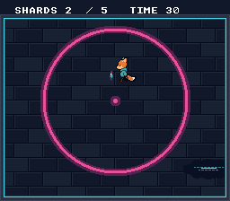

# shard_dash — a game in several files, with a test for each screen

**Game structure · testing.**



## Why it matters for your game

The other examples are one file because each teaches one thing. A real game
is not: it has screens, a save, and a way to be tested without a person
holding the pad. This example is a short game (grab five shards in thirty
seconds) written the way a bigger one should be: **one C file per screen,
one function per mode, one layer for what the screens share.**

## What you'll learn

| File | Role |
|------|------|
| `main.c` | boot, the pump, and the sequence `titleRun() -> playRun() -> resultRun()` |
| `screen.c/h` | the screen layer: VBlank wait, VRAM queue flush, fades, pad edges, pump |
| `title.c`, `play.c`, `result.c` | one screen each, one `xxxRun()` function |
| `save.c/h` | a versioned, checksummed SRAM record |
| `ui.c/h` | text helpers the screens share |
| `game.h` | VRAM layout, the rules, the run's result |

A screen is: compose with the display off, `screenShow()`, loop on
`screenFrame()` + `screenPressed()`, `screenClose()`. The rules the code
shows, each commented where it applies:

- **Nothing freezes the pump.** The pump is the one function run on every
  image (here it counts frames; in a game it is the sound driver). Fades use
  `fadeStart()` / `fadeStep()`, never the blocking `fadeIn()` / `fadeOut()`.
- **A screen undoes what it set up** in a close hook (`screenSetClose()`).
- **VRAM goes through the queue** (`vramQueuePush`), in pieces that keep to a
  budget the game chose (`SCREEN_VBLANK_BUDGET`): what does not fit waits for
  the next VBlank.
- **The save has a magic, a version and a checksum.** Blank or corrupt SRAM
  gives the defaults and the game boots. The record is flat bytes, not a dumped
  struct.
- **State is in named globals**, so a test reads it by name.
- **A key held across a screen change is not a press** on the next screen.
- `SNES_ASSERT` guards an invariant or two (`debug` module): a failed one makes
  the test fail through `wdm_empty`.

## The tests

`testing/manifests/shard_dash_*.toml`, run by `make test-manifests`:

| Manifest | What it checks |
|----------|----------------|
| `shard_dash_title` | the title with the real fade-in: blank SRAM gives the defaults, the fade took 16 images, a picture hash |
| `shard_dash_play` | START, then a scripted walk through the five shards: positions, shard order, score |
| `shard_dash_result_win` | the same walk wins in 108 images; the result, the saved best, START back to the title |
| `shard_dash_result_lose` | a lost round (the clock runs out, nothing saved) with START held from the title on: the result must stay |
| `shard_dash_fade` | the real fade-out and fade-in: 16 images each, not forced blank, the pump running through them |
| `shard_dash_save_1_write` / `_2_read` / `_3_corrupt` | power-cycle: the record is written, reloaded by a new run, and a corrupted copy gives the defaults |

The manifests skip the fades with a `[[poke]]` of `screen_fade_skip`; only
`shard_dash_title` and `shard_dash_fade` play them. The shards come from a
table, so a round is the same every time and a scripted pad can play it.

## Build & run

```bash
make
../../../testing/bin/luna shard_dash.sfc   # luna-gui: START, then the D-pad
```

## Assets

The pictures are the ones of `basics/game_skeleton` (copied, not redrawn).

## Modules used

`console`, `dma`, `background`, `sprite`, `text`, `input`, `vramqueue`, `debug`, `sram`

## Where you are

Next to `basics/game_skeleton` (the same idea as a single `switch`),
`basics/scene_stack` (the `scene` module), `memory/save_game` (raw SRAM) and
`transitions/fading` (the fades).
