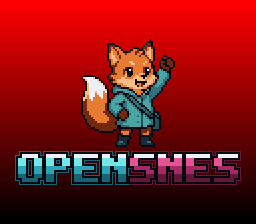

# Gradient Colors -- HDMA Color Gradients


## What This Example Shows

How to create a smooth color gradient across the screen using **HDMA to rewrite CGRAM**
(the palette) every few scanlines. This technique changes the backdrop color (color 0)
as the PPU draws each line, creating sky gradients, underwater effects, or sunset
transitions.

## Prerequisites

Read `effects/hdma_wave` first (HDMA basics and table format).

## Controls

| Button | Action |
|--------|--------|
| A | Remove the gradient (flat background) |
| B | Re-enable the gradient |
| X | The indirect gradient: 32 red bands through a pointer table |

## Build & Run

```bash
cd $OPENSNES_HOME
make -C examples/hdma/gradient_colors
```

Then open `gradient_colors.sfc` in luna (`luna-gui gradient_colors.sfc`) or any emulator.

## How It Works

### 1. HDMA targets CGADD ($2121)

```c
hdmaSetup(HDMA_CHANNEL_6, HDMA_MODE_2REG_2X, HDMA_DEST_CGADD, hdmaGradientList);
```

This configures HDMA mode 3 (`2REG_2X`), which writes **4 bytes per entry** to two
consecutive registers:

| Byte | Register | Purpose |
|------|----------|---------|
| 1 | $2121 | Set CGRAM address (low) |
| 2 | $2121 | Set CGRAM address (high) -- always 0 for color 0 |
| 3 | $2122 | Write color data (low byte of 15-bit color) |
| 4 | $2122 | Write color data (high byte of 15-bit color) |

### 2. The gradient table

Each entry in `hdmaGradientList` is:

```
[line_count] [cgadd_lo=0x00] [cgadd_hi=0x00] [color_lo] [color_hi]
```

The table defines color 0 (backdrop) for groups of scanlines: 28 bands of 8 lines,
the city's sky at dusk, from the night at the top through indigo, violet and
magenta to the amber glow of the streets at the bottom. The picture on BG1 is
the OpenSNES logo, Kit over the wordmark; its sky is colour 0, never drawn, so
the backdrop shows all around him.

The table ends with a `0x00` byte (zero line count = end of HDMA table).

### 3. Toggle at runtime

```c
if (pad0 & KEY_A) hdmaDisableAll();
if (pad0 & KEY_B) enableGradient();
```

HDMA can be enabled/disabled at any time. When disabled, color 0 reverts to
whatever was last written to CGRAM.

### 4. The same effect through indirect HDMA (X)



```c
hdmaSetupIndirect(HDMA_CHANNEL_6, HDMA_MODE_2REG_2X, HDMA_DEST_CGADD,
                  itable, (u8)((u32)(void *)band_data >> 16));
```

With DMAP bit 6 set, a table entry is `[count][ptr_lo][ptr_hi]`: the PPU
fetches the entry's 4-byte payload (`[CGADD][CGADD][color_lo][color_hi]`)
through the pointer, from the bank in `$43x7` — the register plain
`hdmaSetup()` never writes, and `hdmaSetupIndirect()` does. The payloads live
in a WRAM array (`band_data`) the CPU can rewrite at any time without
touching the table: the layout of dynamic per-scanline palettes. A count of
7 fetches the payload once and holds it for 7 lines; a repeat count (`$87`)
would fetch a fresh payload every line, the HiColor pattern.

The gradient is krom (Peter Lemon)'s "Red Space Indirect HDMA" demo, ported
to C: 32 red bands of 7 lines, `$001F` at the top fading to black.

## SNES Concepts

### CGRAM (Color Generator RAM)

The SNES palette holds 256 colors, each stored as a 15-bit value (5 bits per R/G/B
channel). Color 0 is the "backdrop" -- visible wherever no BG or sprite pixel is
drawn. By rewriting color 0 per scanline group via HDMA, each band of the screen
displays a different background color.

### HDMA Mode 3 (2REG_2X)

This mode writes 4 bytes to 2 consecutive registers, 2 bytes each. It is perfect
for CGADD+CGDATA pairs because you need to set the target color address first
(CGADD at $2121), then write the color value (CGDATA at $2122).

### Non-Repeat vs Repeat Mode

This gradient uses non-repeat entries (bit 7 = 0 in the count byte). The color is
written once, then holds for N scanlines. This works because CGRAM latches its
value -- unlike scroll registers (BG1HOFS etc.) which need repeat mode with fresh
writes every scanline.

## Project Structure

| File | Purpose |
|------|---------|
| `main.c` | Gradient setup, enable/disable, input handling |
| `res/logo.png.toml` | the import settings of the picture (`opensnes-tileset`); the build converts and links it |
| `data.asm` | the HDMA gradient table (`hdmaGradientList`), hand-written |
| `res/logo.png` | the OpenSNES logo on a transparent sky, written by `devtools/art_assets/build.py` (CC0) |
| `Makefile` | `LIB_MODULES := console dma background sprite hdma input math` |

## Going Further

- **Custom gradient**: Edit the `hdmaGradientList` table in data.asm. Each entry
  is a 15-bit SNES color (BBBBBGGGGGRRRRR in little-endian). Try a dawn instead
  (dark blue to pale gold).

- **Animated gradient**: Copy the table to RAM and rotate the color entries each
  frame. This creates a flowing color effect like underwater caustics.

- **Explore related examples**:
  - `effects/transparency` -- Color math blending (another way to modify colors)
  - `mode7/perspective` -- HDMA for per-scanline Mode 7 transforms

## Modules Used

`console`, `dma`, `background`, `sprite`, `hdma`, `input` (`LIB_MODULES` in the Makefile).

## Further: the "9-bit" backdrop (two channels, one visual)

krom's RedSpace9BitHDMA trick: one channel rewrites the backdrop colour per scanline exactly as this
example does, and a second channel rewrites INIDISP's master brightness per
scanline. That second channel writes INIDISP through `$21FF`:
`hdmaSetup(ch, HDMA_MODE_2REG, 0xFF, table)`, which writes `$21FF` (nothing)
then `$2100`, with table entries `count, value, value` and `$8F` rather than
`$80` for a blank band. A one-register HDMA straight into `$2100` can make a
general DMA fail on an S-CPU-A console (`KNOWN_LIMITATIONS.md`, "An HDMA to
INIDISP"). Colour x brightness, plus a
one-line jitter, dithers the 5-bit gradient into more perceptual steps than
the PPU has. INIDISP then belongs to the stream: the program never calls
`setScreenOn()` itself, and the brightness table must end at full
brightness or the screen stays dim after the last line.
