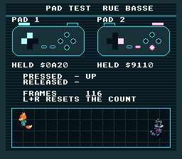

# Controller Input — Both Pads, the Edges, the Frame Count

Reads both SNES controllers and shows, for each, every button held — one
letter a button, so several at once show together. Under them: the last
button pressed and the last button released on pad 1, and the number of
VBlanks since boot. The screen the console check uses (rows 2 and 14 of
`docs/HARDWARE_VERIFICATION.md`).



## What You'll Learn

- How to read controller state with `padHeld(pad)` (a 16-bit bitmask), for
  pad 1 and pad 2
- The edges: `padPressed(pad)` (went down this frame) and `padReleased(pad)`
  (came up this frame)
- The SNES button constants, in the order the pad shifts them out: `KEY_B`,
  `KEY_Y`, `KEY_SELECT`, `KEY_START`, `KEY_UP`, `KEY_DOWN`, `KEY_LEFT`,
  `KEY_RIGHT`, `KEY_A`, `KEY_X`, `KEY_L`, `KEY_R`
- That the NMI handler reads joypads automatically — no manual polling needed
- `frame_count`, the VBlank counter the NMI handler keeps
- The `gameloop` framework: `on_init` once, `on_update` once per VBlank

## Controls

| Input | Display |
|-------|---------|
| Any buttons on pad 1 / pad 2 | their letters on the PAD 1 / PAD 2 line while held: `B Y E S ^ V < > A X L R` (E = SELECT, S = START, the arrows = the D-pad) |
| A press / a release on pad 1 | PRESSED / RELEASED name the button |
| L and R together | the frame counter goes back to 0, once, on the frame the pair is completed |

## SNES Concepts

### How Input Works on the SNES

The SNES joypad is a shift register — the hardware clocks out 16 bits of button state every frame during the auto-joypad read period (after VBlank). The NMI handler in `crt0.asm` captures this automatically into `pad_keys[]`. Your code never touches hardware registers directly.

### padHeld vs padPressed

```c
u16 held = padHeld(0);      // Buttons held RIGHT NOW (every frame)
u16 pressed = padPressed(0); // Buttons pressed THIS FRAME ONLY (edge detection)
```

Use `padHeld` for continuous actions (movement, charging). Use `padPressed` for one-shot actions (jump, menu select, pause toggle), and `padReleased` for what happens when a button comes up (release a charged shot, end a long jump early).

### Two Pads

`padHeld(1)`, `padPressed(1)` and `padReleased(1)` read the second pad the same
way; each pad has its own state, so releasing pad 2 changes nothing on pad 1.

### Button Bitmask

Multiple buttons can be held simultaneously. Test with bitwise AND:

```c
if (pad & KEY_A) { /* A is held */ }
if ((pad & (KEY_L | KEY_R)) == (KEY_L | KEY_R)) { /* both shoulders held */ }
```

## Modules Used

| Module | Why it's here |
|--------|--------------|
| `console` | `consoleInit()`, `WaitForVBlank()`, NMI handler setup |
| `sprite` | OAM buffer (required by NMI handler even with no visible sprites) |
| `dma` | DMA transfers used internally by console init |
| `background` | BG layer configuration |
| `text` | `textInit()`, `textPrintAt()`, `textFlush()` for button name display |
| `input` | `padHeld()`, `padPressed()`, `padReleased()` for both pads |
| `gameloop` | `gameLoopRun()`: the init / update shape of the program |


## Build & Run

```bash
cd $OPENSNES_HOME
make -C examples/input/controller
```

Open `controller.sfc` in Mesen2 and press buttons.
