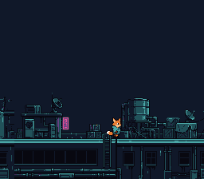

# Map Scroll

A level drawn in the [Tiled](https://www.mapeditor.org/) map editor scrolls as Kit, the fox-kit courier, walks left and right along a row of rooftops at night. The map engine streams only the visible tile columns to VRAM, so the map can be much wider than the screen; the level, its tile properties and its tileset are converted by the build from settings files beside them.



## What You'll Learn

- How to design a level in Tiled and convert it for the SNES (Tiled → opensnes-level → ROM)
- How tile properties (collision, palette, priority) flow from Tiled to the game
- How the map engine streams a large level through a small VRAM window
- How camera-follow works: sprite position drives the viewport
- How to combine a scrolling background with an animated sprite
- The two-phase update pattern: `mapUpdate()` (CPU) → `mapVblank()` (DMA)
- Sprite screen positioning relative to camera (`xloc - mapGetCameraX()`)

## Controls

| Button | Action |
|--------|--------|
| LEFT | Move Kit left (sprite flips, map scrolls) |
| RIGHT | Move Kit right |

## The Tiled Workflow

```
  Tiled Editor           opensnes-tileset       opensnes-level
┌──────────────┐        ┌──────────────┐      ┌──────────────┐
│ Paint tiles  │        │ tileset.png  │      │ level.tmj    │
│ Set props    │        │      ↓       │      │ + tileset.map│
│ Export .tmj  │        │ .pic .pal .map│     │      ↓       │
└──────┬───────┘        └──────────────┘      │ .m16 .t16 .b16│
       │                                      └──────────────┘
       └── Your level data, ready for mapLoad()
```

**Step 1.** Design the level in Tiled (8x8 pixel tiles, any width/height up to
16384 tiles in all). Set per-tile properties: `attribute` (collision),
`palette` (0-7), `priority` (0-1).

**Step 2.** Export it as `.tmj` (JSON).

**Step 3.** The tileset picture is converted by `opensnes-tileset`, from its
settings file `res/roofs.png.toml`:
```toml
tool = "opensnes-tileset"

[convert]
colors = 16
# Outputs: .pic (tiles), .pal (palette), .map (tile optimization table), .inc (the C declarations)
```

**Step 4.** The level is converted by `opensnes-level`, after the tileset whose
`.map` its settings file names (`res/rooftops.tmj.toml`):
```toml
tool = "opensnes-level"

[convert]
tileset = "roofs.map"
# Outputs: BG1.m16 (tilemap), rooftops.t16 (tile defs), rooftops.b16 (attributes),
#          rooftops.o16 (entities), rooftops.inc (the C declarations)
```

**Step 5.** The build links the converted data (`res/roofs.inc` and
`res/rooftops.inc` declare it); `mapLoad()` takes it — no `data.asm`.

The level here is one long row of rooftops (2304 pixels, 802 distinct tiles)
and Kit is a 32x32 sprite of eight walk frames; both are generated for
OpenSNES (CC0, `assets/neo-lumen/`), and `devtools/art_assets/build.py`
writes `res/rooftops.tmj` and its tile sheet `res/roofs.png` from them. Open
the `.tmj` in Tiled to edit the level: each tile of the sheet carries its
`attribute` (`FF00` for the roof and the walls under it).

### Tile Properties

Each tile in the Tiled editor can carry custom properties:

| Property | Tiled Field | SNES Effect |
|----------|------------|-------------|
| `attribute` | Hex string (e.g., `"FF00"`) | Collision type: `T_SOLID`, `T_LADDER`, `T_SPIKE`, etc. |
| `palette` | Hex string (e.g., `"1"`) | Palette bank (bits 10-12 of tilemap entry) |
| `priority` | Hex string (e.g., `"1"`) | BG priority bit (bit 13 of tilemap entry) |

opensnes-level stores them in the `.b16` (attributes) and `.t16` (palette and
priority) files.

## SNES Concepts

### Map Engine Two-Phase Update

The map is too large to fit in VRAM. The map engine solves this:

1. **`mapUpdate()`** — runs during active display. Checks if the camera crossed a tile boundary. If so, prepares a column of new tiles in a RAM buffer.
2. **`mapVblank()`** — runs during VBlank. DMAs the prepared tile column to VRAM. This is the only safe time to write VRAM.

### Camera-Relative Sprite Positioning

The sprite's position in the map (`xloc`) is not its screen position. The screen position is `xloc - mapGetCameraX()`, where `mapGetCameraX()` is the camera's current offset exported by the map engine.

```c
oamSet(0, xloc - mapGetCameraX(), yloc - mapGetCameraY(), frame, 0, 3, flags);
```

### Walk Animation

The sprite cycles through 4 frames (tiles 0, 2, 4, 6). Each 16x16 sprite uses 2 VRAM tiles (top-left + top-right), so frames are spaced by 2. Animation advances every other input frame for natural pacing.

## Modules Used

| Module | Why it's here |
|--------|--------------|
| `console` | `consoleInit()`, `WaitForVBlank()`, NMI handler setup |
| `sprite` | OAM buffer for Kit, a 32x32 sprite |
| `dma` | DMA transfers for tiles, palette, and map column streaming |
| `input` | `padHeld()` for continuous D-pad reading |
| `background` | BG layer and scroll register configuration |
| `map` | `mapLoad()`, `mapUpdate()`, `mapVblank()` — the streaming map engine |

## Build & Run

```bash
cd $OPENSNES_HOME
make -C examples/maps/map_scroll
```

Run `map_scroll.sfc` in luna (`opensnes run`) or any SNES emulator and scroll with LEFT/RIGHT.
