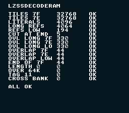

# LZ77 into RAM — lzssDecodeRam



## What This Example Shows

How to decompress LZ77 data into work RAM while the game runs. `lzssDecodeVram`
writes straight into VRAM, so it needs forced blank; `lzssDecodeRam` writes into
RAM of any bank instead, touches no PPU register and leaves the NMI enabled. A
game decompresses the next tiles with the screen on, then sends them to VRAM by
DMA in VBlank (`dmaCopyVram`, or the VRAM queue).

The example decodes, screen on, a 2 bpp tile block compressed by
`opensnes-sprite` (32768 bytes from 17856) into bank $7F and into a `FAR` buffer
of bank $7E, and compares each copy byte for byte with the same tiles converted
without compression. Hand-built streams (`streams.asm`) then cover what the
compressor never writes: overlapping references, a reference cut at the end of
the output, an output that ends exactly at the end of bank $7F, and the four
streams that must be refused. One line per test on screen: name, bytes
returned, OK or BAD.

## SNES Concepts

- LZ77 (type 0x10): a flag byte before every eight items, a literal byte or a
  back reference of 3 to 18 bytes up to 4096 bytes back
- The 128 KB of work RAM: bank $7E (where `FAR` objects live) and bank $7F,
  reached through a pointer such as `(u8 FAR *)0x7F0000UL`
- MVN, the 65816 block move: it copies one byte at a time upwards, so a
  reference whose distance is shorter than its length repeats a pattern, which
  is what LZ77 means (distance 1 = one byte repeated)
- Decompressing with the screen on: the NMI keeps running during the decode

## Build & Run

```bash
cd $OPENSNES_HOME
make -C examples/memory/lzss_ram
```

The tests run with the screen on and take about five seconds (most of it is
the C code that fills and compares 32 KB buffers, not the decoder); the lines
appear when they are done.

## How It Works

```c
#include <snes/lzss.h>
#include "res/tiles_lz.inc"          /* tiles_lz_tiles: the LZ77 stream */

static FAR u8 tiles[32768];

u16 n = lzssDecodeRam(tiles_lz_tiles, tiles);              /* bank $7E */
u16 m = lzssDecodeRam(tiles_lz_tiles, (u8 FAR *)0x7F0000UL); /* bank $7F */
```

The return value is the number of bytes written. It is 0, and nothing is
written, when the stream's tag is not 0x10, its length is 0 or above 65535, or
the output would run past the end of the destination bank.

| Test | Stream | Destination | What it proves |
|---|---|---|---|
| TILES 7F / 7E | tiles from `opensnes-sprite --lz` | $7F:0000, `FAR` buffer | the real data, both MVN paths |
| LITERALS | 4096 literals | $7F:9000 | the eight-literal fast path |
| LONG REFS | 32 literals + 224 references of 18 bytes | `FAR` buffer | MVN on long copies |
| REFS LOW | the same, 194 bytes | a plain buffer (bank $00) | the byte-loop copy of other banks |
| CUT AT END | 'A' + 18 x 'A' in a 5-byte stream | $7F:C000 | a reference past the end is cut |
| OVL LONG | distance 1, 2 and 3, 330 bytes | $7F, $7E, bank $00 | overlap through MVN |
| OVERLAP | distance 1, 2 and 3, 44 bytes | $7F, $7E, bank $00 | overlap in the last 144 bytes |
| END OF 7F | 44 bytes ending at $7F:FFFF | $7F:FFD4 | the end address wraps to $0000 |
| LENGTH 0, OVER 64K, TAG 11, CROSS BANK | refused streams | | 0 returned, the destination untouched |

Each test also checks the 16 bytes after its output: the decoder never writes
past the end. The luna manifest `testing/manifests/memory_lzss_ram.toml` asserts
every result.

## Cost

Master cycles per output byte, measured with `luna profile` on this ROM (each
decode run alone, selected by poking `bench_sel`):

| Stream | SlowROM (this build) | FastROM (`USE_FASTROM := 1`) |
|---|---|---|
| literals only (4096 bytes) | 104 | 88 |
| long references (4064 bytes) | 101 | 87 |
| 2 bpp tiles, 17856 → 32768 bytes | 163 | 139 |

```bash
testing/bin/luna profile examples/memory/lzss_ram/lzss_ram.sfc \
  --poke-at main --poke bench_sel=03 --until-frame 120
```

(`bench_sel` = 1 literals, 2 long references, 3 tiles; add the rows whose
symbol starts with `lzssDecodeRam`.) For comparison, `lzssDecodeVram` measured the
same way on the 4 bpp tiles of `backgrounds/mode1` (28256 bytes): 709 master cycles per byte. 32 KB of tiles take about 5.4 million
master cycles, 15 frames: spread over frames, a game decompresses a few KB per
frame beside its own work. The ROM cost is 376 bytes, for a ROM that calls
`lzssDecodeRam`; a ROM that only calls `lzssDecodeVram` does not link it.

## Modules Used

`console`, `dma`, `text`, `background`, `sprite`, `lzss`

## See Also

- `backgrounds/mode1` — `lzssDecodeVram`, the same format straight into VRAM
- [Far RAM tutorial](../../../docs/tutorials/far_ram.md) — `FAR` buffers in bank $7E
