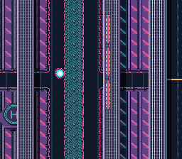

# Mode 7 EXTBG

> One Mode 7 plane split into two layers by bit 7 of its pixels, with an
> energy orb flying between them.



SETINI bit 6 (EXTBG) gives Mode 7 a BG2 that shows the same plane as BG1
but reads bit 7 of every pixel as a priority bit. The plane is the city
seen from above with the elevated metro over it: the pixels of the three
viaducts and of the train have bit 7 set, those of the streets, roofs and
canal below have it clear. So the orb, a priority-1 sprite, flies over the
roofs and under the viaducts of one single plane. Press **A** to switch
EXTBG off: BG1 is shown instead, one layer, and the orb covers the viaducts
too.

## Build & Run

```bash
cd $OPENSNES_HOME
make -C examples/mode7/extbg
```

Open `extbg.sfc` in luna (or any SNES emulator) and press A.

## SNES Concepts

- **SETINI ($2133) bit 6**, Mode 7 EXTBG, through `mode7SetExtBg()` (the
  lib keeps a shadow of the write-only register, shared with the other
  SETINI setters)
- **EXTBG priority**, front to back: sprites 3, sprites 2, BG2 pixels with
  bit 7 set, sprites 1, BG1, sprites 0, BG2 pixels with bit 7 clear
  (anomie's register doc, *Mode 7*) — hence BG2 alone on the main screen
- **One pixel, two colours**: BG2 reads bits 0-6, BG1 all eight, so a
  viaduct pixel `0x81` is colour 1 on BG2 and colour 129 on BG1. The
  viaducts use colours 1-13, the palette repeats them at 129-141, and the
  city's colours start at 16; the palette stops at 143, below the orb's
  sprite palette at 144
- **Mode 7 at 1:1**: `mode7SetScale(0x0100, 0x0100)` and
  `mode7SetScroll(0, 0)` put plane row 0 on the first line; the 256x224
  window shown repeats over the 1024x1024 plane
- **A Mode 7 plane from a picture**: `res/plane.png` (8bpp, indexed)
  converted by `opensnes-tileset` (`mode = 7`) into packed tiles and a
  byte map, uploaded interleaved by `dmaCopyVramMode7()`

## What You'll See

- The city at night from above: roofs, a cross street, a canal, and three
  viaducts of the elevated metro with a train on the middle one. The orb
  crosses the screen left and right, pulsing, hidden under each viaduct as
  it passes.
- **A**: EXTBG off — the orb is drawn over the viaducts. **A** again: back.

## Assets

`res/plane.png` and `res/orb.png` are made by
`devtools/art_assets/build.py` (`mode7.py`): the city window is cut from
the Mode 7 city of the other examples (PixelLab tilesets, CC0), the
viaducts, the train and the orb are drawn there.

## Testing

`testing/manifests/mode7_extbg.toml` checks SETINI ($40 / $00 /
$40) and the main-screen designation across two A presses, the 1:1 matrix
and the scroll, and that the orb moves. The visual baselines capture the
occlusion.

## Modules Used

| Module | Purpose |
|--------|---------|
| `console` | System initialization, `WaitForVBlank` |
| `dma` | Mode 7 VRAM upload, palettes, sprite tiles |
| `sprite` | The orb (OAM) |
| `input` | The A button |
| `mode7` | Matrix, scroll, `mode7SetExtBg()` |
