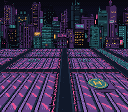

# Mode 7 Perspective -- Pseudo-3D Ground Effect



## What This Example Shows

How to combine Mode 7 with HDMA to create a **perspective ground plane** -- the same
technique used in F-Zero, Mario Kart, and Pilotwings. The screen is split in two:
a static sky on top and a scaled ground that recedes into the distance.

## Prerequisites

Read `mode7/rotate_scale` first (Mode 7 basics), then `hdma/hdma_wave`
(HDMA tables written per scanline).

## Controls

| Button | Action |
|--------|--------|
| D-PAD | Scroll the ground plane |

## Build & Run

```bash
cd $OPENSNES_HOME
make -C examples/mode7/perspective
```

Then run `perspective.sfc` in luna (`opensnes run`) or any SNES emulator.

## How It Works

### 1. Split-screen with HDMA

The screen is divided by 4 HDMA channels running every frame:

| Channel | Target | Effect |
|---------|--------|--------|
| Ch1 | BGMODE ($2105) | Switches from Mode 1 (sky) to Mode 7 (ground) |
| Ch2 | TM ($212C) | Switches from BG2 (sky tiles) to BG1 (Mode 7 ground) |
| Ch3 | M7A ($211B) | Per-scanline horizontal scale (perspective) |
| Ch4 | M7D ($211E) | Per-scanline vertical scale (perspective) |

Top 96 scanlines: Mode 1 displays the sky on BG2.
The lines below: Mode 7 displays the ground with per-scanline scaling.

The four tables are set up once with `hdmaSetup()`: the hardware reads each
from its start again at the top of every frame.

### 2. Perspective math

The key to the 3D illusion: scanlines near the top of the ground area (the
"horizon") use a large scale value (small objects = far away), while scanlines
near the bottom use a small scale value (large objects = close up).

Two pre-computed tables in `main.c`, `perspective_x` and `perspective_y`,
give each ground scanline its own M7A and M7D.

### 3. Scrolling

```c
if (pad0 & KEY_LEFT)  sx--;
if (pad0 & KEY_RIGHT) sx++;
if (pad0 & KEY_UP)    sy--;
if (pad0 & KEY_DOWN)  sy++;

WaitForVBlank();
setCamera();   /* mode7SetScroll, mode7SetCenter, bgSetScroll for the sky */
```

`mode7SetScroll()` and `mode7SetCenter()` write the registers at once, so
they run right after `WaitForVBlank()`.

## SNES Concepts

### Mode Switching Mid-Frame

The SNES allows changing the BGMODE register ($2105) via HDMA between scanlines.
This is how one screen shows two completely different video modes -- Mode 1 for
the sky portion and Mode 7 for the ground portion. The switch happens during
HBlank, so there is no visible glitch.

### Per-Scanline Scaling

By writing M7A/M7D on every scanline (HDMA repeat mode: a new value each line), each horizontal line of
the ground has a different scale factor. Lines near the horizon are scaled way
down (far away), lines at the bottom are close to 1:1 (nearby). This creates the
depth illusion without any 3D math at runtime -- it is all pre-computed tables.

### HDMA Budget

HDMA takes its time from the CPU on every line where a channel is active: about
18 master cycles, plus 8 per active channel and 8 per byte written (anomie's
register notes; at most 466 master cycles a line, all eight channels on). Here,
on a ground line: 18 + 4 x 8 + 4 bytes x 8 = 82 master cycles of the 1364 a
scanline lasts.

## Project Structure

| File | Purpose |
|------|---------|
| `main.c` | The HDMA tables, their setup, input and the camera |
| `res/ground.png.toml`, `res/sky.png.toml` | the import settings of the ground (Mode 7) and the sky (`opensnes-tileset`); the build converts and links them |
| `res/ground.png` | the city from above, 1024x1024 in 235 tiles (CC0, `assets/neo-lumen/`) |
| `res/sky.png` | the towers over the horizon, 512x256; its 16 colours are the ground's first sixteen, the palette both read (`devtools/art_assets/mode7.py` writes the two) |
| `Makefile` | `LIB_MODULES := console dma background sprite input mode7 hdma` |

## Going Further

- **Add rotation**: `mode7/perspective_rotate` drives all four matrix terms
  per line from precomputed tables, one set per angle.

- **Add sprites**: Place car or character sprites on top of the ground plane.
  Sprites render normally in Mode 7 and can be scaled/positioned to match the
  perspective.

- **Explore related examples**:
  - `hdma/gradient_colors` -- Another HDMA technique (color gradients)
  - `games/likemario` -- Scrolling backgrounds with sprites (different approach)

## Modules Used

`console`, `dma`, `background`, `sprite`, `input`, `mode7`, `hdma` (`LIB_MODULES` in the Makefile).
