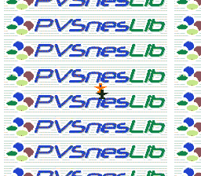

# Mode 7 -- Rotation and Scaling



## What This Example Shows

How to use the SNES Mode 7 -- a special background mode that applies an affine
transformation (rotation + scaling) to a single 128x128 tile layer. This is the
same technique behind F-Zero's ground, Mario Kart's tracks, and Pilotwings' maps.

A glider flies over the plane, and the zoom is its altitude: zoom out and the
view widens as if it climbed, while its shadow slides further away; zoom in
and the shadow closes in. Scale and shadow are the two cues that make a flat
Mode 7 plane read as height.

## Prerequisites

Read `backgrounds/mode1` first (basic background setup). Mode 7 is fundamentally
different from tile-based modes but the initialization flow is similar.

## Controls

| Button | Action |
|--------|--------|
| A | Rotate clockwise |
| B | Rotate counter-clockwise |
| D-PAD Up | Zoom out (see more of the plane) — the glider climbs, its shadow drifts away |
| D-PAD Down | Zoom in (magnify) — the glider descends, its shadow closes in |

## Build & Run

```bash
cd $OPENSNES_HOME
make -C examples/mode7/rotate_scale
```

Then open `rotate_scale.sfc` in luna (`luna-gui rotate_scale.sfc`) or any emulator.

## How It Works

### 1. Mode 7 VRAM format

Mode 7 uses a special interleaved VRAM format:
- **Even bytes**: tilemap entries (128x128 = 16,384 tiles)
- **Odd bytes**: pixel data (256 tiles, 8x8, 256 colors each)

This is completely different from Modes 0-3 where tilemap and tile data are in
separate VRAM regions. `main.c` calls `dmaCopyVramMode7()`, which writes the
tilemap and the tile data into the interleaved format the PPU expects (two
DMAs with different VMAIN settings), then `dmaCopyCGram()` for the palette.

### 2. Initialize the transformation

```c
setMode(BG_MODE7, 0);
mode7Init();
mode7SetScale(0x0100, 0x0100);
mode7SetAngle(0);
```

`mode7Init()` sets the rotation center to the screen center (128, 128).
Scale `0x0100` is 1:1 (one texel per pixel).

### 3. Update the matrix every frame

```c
if (pad0 & KEY_A) {
    angle++;
    mode7SetAngle(angle);
}
```

`mode7SetAngle()` recalculates the 2x2 transformation matrix (registers M7A-M7D
at $211B-$211E) using the current angle and scale. The angle is 0-255, mapping to
0-360 degrees.

### 4. Zoom control

```c
if (pad0 & KEY_UP) {
    if (zscale < 0x0780) zscale += 8;
    mode7SetScale(zscale, zscale);
    mode7SetAngle(angle);
}
```

After changing the scale, you must call `mode7SetAngle()` again because the matrix
depends on both angle and scale. The scale range is clamped to `0x0008`-`0x0780` --
values outside this range produce extreme distortion.

### 4. The rotation centre, and the glider on it

`M7X`/`M7Y` name the point of the plane the matrix turns around; the scroll
(`M7HOFS`/`M7VOFS`) says where that point lands on screen. `mode7Init()` sets
the centre to (128, 128) and leaves it above the screen, so the example
scrolls by (0, 16) to put it on screen line 112, the middle:

```c
mode7SetScroll(0, 16);       /* plane point (128, 128) -> screen (128, 112) */
```

The glider is Kit's, a 32x32 sprite drawn there; the plane turns under it.
Its shadow is the same picture in an all-dark palette, drawn `zscale >> 5`
pixels below: 8 at 1:1, up to 60 at the widest view. The glider is OAM entry
0 and the shadow entry 1: between two sprites the lower index is drawn in
front, whatever their priority bits, which only rank a sprite against the
backgrounds ([SNESdev wiki, Sprites](https://snes.nesdev.org/wiki/Sprites)).

## SNES Concepts

### Affine Transformation

Mode 7 applies a 2x2 matrix to BG1. The matrix encodes rotation, scaling, and skew.
The hardware computes the transform per-scanline using four registers:

| Register | Address | Purpose |
|----------|---------|---------|
| M7A | $211B | Matrix element A (cosine * scale) |
| M7B | $211C | Matrix element B (sine * scale) |
| M7C | $211D | Matrix element C (-sine * scale) |
| M7D | $211E | Matrix element D (cosine * scale) |

### One Layer Only

Mode 7 supports exactly one background (BG1). No BG2/BG3/BG4.
Sprites still work normally on top, which is how F-Zero renders its cars.

### 256-Color Palette

Each Mode 7 tile uses 256 colors (8bpp), unlike Modes 0-3 which use 2/4/8 colors
per palette. This gives richer visuals but limits you to 256 unique tiles total.

### 8.8 Fixed-Point Scale

`0x0100` = 1:1, `0x0200` = shrunk twice (shows more area), `0x0080` =
magnified twice. The integer part is the high byte, the fractional part is
the low byte.

## Project Structure

| File | Purpose |
|------|---------|
| `main.c` | Input handling, rotation/zoom logic, the glider and its shadow |
| `res/mode7bg.png.toml` | the import settings of the Mode 7 picture (`opensnes-tileset`, `mode = 7`); the build converts and links it, `res/mode7bg.inc` declares the symbols |
| `res/mode7bg.png` | the city from above, 1024x1024 in 235 tiles, written by `devtools/art_assets/mode7.py` (CC0, `assets/neo-lumen/`) |
| `res/glider.png`, `res/glider.png.toml` | Kit's glider from above, 32x32 (`opensnes-sprite`) |
| `Makefile` | `LIB_MODULES := console dma background sprite input mode7` |

## Going Further

- **Fly forward**: move the centre along the heading with `mode7SetCenter()`
  and the same scroll offset, as `mode7/mode7_racing` drives its kart.

- **Explore related examples**:
  - `mode7/perspective` -- Per-scanline scaling for pseudo-3D (F-Zero style)
  - `hdma/hdma_wave` -- HDMA can modify Mode 7 parameters per scanline

## Modules Used

`console`, `dma`, `background`, `sprite`, `input`, `mode7` (`LIB_MODULES` in the Makefile).
