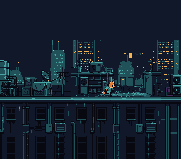

# Continuous Scroll

> A threshold camera over two layers in parallax: Kit runs on the roofs, the far
> towers follow at half the speed. Hold the D-pad and the world scrolls to follow him.



## Controls

| Button | Action |
|--------|--------|
| D-Pad Left/Right | Run |

## What You'll Learn

- How SNES background scrolling actually works (it's not moving tiles -- it's moving the camera)
- The threshold camera: only scroll when the player reaches a line of the screen
- Parallax: two layers with independent scroll offsets, the far one slower
- A 64x32 background: two 32x32 pages, 512 px of world without a map engine
- Why scroll register updates must happen during VBlank (and how bgSetScroll's dirty-flag mechanism guarantees it)

---

## Build & Run

```bash
cd $OPENSNES_HOME
make -C examples/scrolling/continuous_scroll
```

Then open `continuous_scroll.sfc` in luna (or any SNES emulator).

## Walkthrough

### 1. Two Layers, Two Speeds

This example uses Mode 1 with two background layers: BG1 is the roofs Kit runs
on, BG2 the far towers behind them. Both are 512 px wide, so each map is 64x32
entries — two 32x32 pages side by side:

```c
bgSetMapPtr(0, 0x0000, SC_64x32);   /* BG1 map at $0000, 2 pages */
bgSetMapPtr(1, 0x0800, SC_64x32);   /* BG2 map at $0800, 2 pages */

bgInitTileSet(0, roofs_tiles, roofs_pal, 2,     /* BG1 tiles at $1000 */
              ..., BG_16COLORS, 0x1000);
bgInitTileSet(1, skyline_tiles, skyline_pal, 4, /* BG2 tiles at $4000 */
              ..., BG_16COLORS, 0x4000);
```

The roofs are 600 distinct tiles (19 KB, $1000-$357F): they are loaded in force
blank, before `setScreenOn()`, far over one VBlank's DMA budget.

> **Why palette slot 2 and 4?** Each BG palette slot holds 16 colors. Slot 0 starts
> at CGRAM address 0, slot 2 at address 32, slot 4 at address 64. Using different
> slots means BG1 and BG2 get independent color palettes.

### 2. The Threshold Camera

Kit moves freely between two lines of the screen (x 80 and x 140). What he goes
past one, the world scrolls instead, and he is put back on the line:

```c
if (game.player_x > SCROLL_THRESHOLD_RIGHT && game.bg1_scroll_x < MAX_SCROLL_X) {
    d = game.player_x - SCROLL_THRESHOLD_RIGHT;
    if (d > MAX_SCROLL_X - game.bg1_scroll_x) d = MAX_SCROLL_X - game.bg1_scroll_x;
    game.bg1_scroll_x += d;
    game.player_x -= d;   /* back on the threshold */
}
```

Kit runs right, reaches x 140, and stays there while the roofs go by under him. It
looks like the camera is following him, but it's actually the background moving in
the opposite direction. At the end of the roofs (`MAX_SCROLL_X`, 512 − 256) the
scroll stops and Kit runs on to the edge of the screen.

### 3. Parallax

The far layer moves at half the speed of the near one:

```c
game.bg2_scroll_x = game.bg1_scroll_x >> 1;
```

The difference in speed is the whole depth illusion: the eye reads what moves
slower as further away.

### 4. Scroll Updates via bgSetScroll Dirty Flags

Scroll registers are write-only and take effect immediately. If you write them during
active display (while the PPU is drawing), you'll get a visible tear -- the top half of
the screen shows the old scroll position, the bottom half shows the new one.

This example calls `bgSetScroll()` from the main loop, which does NOT write to the PPU
directly. Instead, it stores the new scroll values and sets a dirty flag. The NMI handler
(triggered at VBlank) checks the dirty flags and writes the actual scroll registers at
a safe time:

```c
/* In the main loop -- sets dirty flags, does NOT touch PPU registers */
bgSetScroll(0, game.bg1_scroll_x, game.bg1_scroll_y);
bgSetScroll(1, game.bg2_scroll_x, game.bg2_scroll_y);
```

The initial scroll values are also set before `setScreenOn()` so the first visible
frame shows the right rows.

### 5. Kit

Kit is one 32x32 sprite: four idle frames and eight running frames in
`res/kit.png`. A 32x32 frame is 4x4 tiles, and a row of sprite tiles in VRAM is
16 tiles wide, so frame f starts at tile `(f % 4) * 4 + (f / 4) * 64`. His
frames face right; running left sets the attribute's H-flip bit (`OBJ_FLIPX`).

---

## Tips & Tricks

- **Kit gets stuck at the edge?** Check your threshold values. If
  `SCROLL_THRESHOLD_RIGHT` is too high (close to 256), he can run off-screen
  before scrolling kicks in.

- **Sprite disappears at the left edge?** The SNES uses 9-bit X coordinates for sprites.
  Values below 0 wrap to 256+, which is off-screen. Clamp `player_x` to a minimum of 0.

---

## Go Further

- **A longer world:** 64x32 is the largest map one BG holds. For more, upload new
  tile columns as the camera scrolls. See [map_scroll](../../maps/map_scroll/) and
  [likemario](../../games/likemario/).

- **Add vertical scrolling:** Same pattern, but with Y thresholds and `bg_scroll_y`.

- **Next example:** [likemario](../../games/likemario/) -- full platformer with gravity,
  collision, and tile streaming.

---

## Assets

`res/roofs.png` is four roof pieces of likemario side by side at one height,
`res/skyline.png` likemario's far towers, and `res/kit.png` Kit's idle and running
frames from his side sheet: all made by `devtools/art_assets/build.py` from the
Néo-Lumen art (PixelLab, CC0; `assets/neo-lumen/README.md`). The build converts
them, from the settings file beside each (`opensnes-tileset`, `opensnes-sprite`).

## Modules Used

`console`, `sprite`, `input`, `background`, `dma` (`LIB_MODULES` in the Makefile).

| Module | Why it's here |
|--------|--------------|
| `console` | PPU setup, NMI handler, `WaitForVBlank()` |
| `sprite` | OAM buffer for Kit |
| `input` | `padHeld()` |
| `background` | `bgSetMapPtr()`, `bgSetScroll()`, `bgInitTileSet()` with dirty-flag deferred writes |
| `dma` | `dmaCopyVram()` for the maps, plus OAM DMA in NMI |

## Technical Reference

| Register | Address | Role in this example |
|----------|---------|---------------------|
| BGMODE   | $2105   | Mode 1 (two 4bpp layers + one 2bpp) |
| BG1SC    | $2107   | BG1 map at $0000, 64x32 |
| BG2SC    | $2108   | BG2 map at $0800, 64x32 |
| BG1HOFS  | $210D   | BG1 horizontal scroll (via bgSetScroll) |
| BG2HOFS  | $210F   | BG2 horizontal scroll, half of BG1's |
| TM       | $212C   | Enable OBJ + BG2 + BG1 |

## Files

| File | What's in it |
|------|-------------|
| `main.c` | The camera, the parallax, Kit's animation |
| `res/*.png.toml` | the import settings of the two layers and Kit's sheet (`opensnes-tileset`, `opensnes-sprite`); the build converts and links them, `res/<name>.inc` declares the symbols |
| `Makefile` | `LIB_MODULES := console sprite input background dma` |

## Credits

- Original example: odelot (PVSnesLib)
- Art: Néo-Lumen (PixelLab, CC0), arranged by `devtools/art_assets/build.py`
