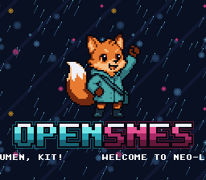

# Mixed Scroll

Three Mode 1 background layers displayed simultaneously with independent scroll
behavior — the title screen of the Néo-Lumen examples: BG1 (the night and its
rain, a picture that repeats) auto-scrolls diagonally every frame, BG2 (the logo,
Kit and the wordmark) remains fixed in place, and BG3 carries a line of text
that slides left — a scrolling message is a scrolled background like any
other. This demonstrates how the SNES PPU can scroll each background layer
independently, which is the foundation for parallax effects, title screens with
animated backgrounds, and layered game worlds.



## What You'll Learn

- How to load two background layers with separate tilesets and palettes
- How to assign different CGRAM palette slots to different layers
- How to scroll one background while keeping another stationary
- How to put the text module on a layer of your choice (BG3) and scroll it
- How the SNES VRAM layout must be planned to avoid tile/tilemap overlap

## SNES Concepts

### Mode 1 with Multiple Backgrounds

Mode 1 provides three background layers: BG1 and BG2 are 4bpp (16 colors each),
and BG3 is 2bpp (4 colors). Each layer has its own tilemap and tile data in
VRAM, and each can reference a different palette slot from CGRAM.

### BG3: the Message

```c
textLoadFont(VRAM_BG3_FONT);         /* the 2bpp font, BG3's character base */
textInit(VRAM_BG3_MAP, 0, 7);        /* BG3's map, font tile 0, palette slot 7 */
text_config.priority = 1;            /* the tile priority bit */
setColor(29, RGB(31, 31, 31));       /* slot 7, colour 1 */
textPrintAt(2, 24, "WELCOME TO NEO-LUMEN, KIT!");
setMode(BG_MODE1, BG3_MODE1_PRIORITY_HIGH);
...
bgSetScroll(2, ++msgX, 0);           /* each frame: the message slides left */
```

BG3's 2bpp palettes come from CGRAM 0-31, the same colours as the 4bpp
layers' first two slots: here BG2 takes 0-15 and BG1 16-28 (the rain has
thirteen colours), so the text takes 2bpp slot 7, colours 28-31 — colour 28
is the slot's transparent one, and 29 is free. In Mode 1, BG3 is behind the
other layers unless `BG3_MODE1_PRIORITY_HIGH` is set and its tiles carry the
priority bit — both are, so the message is in front.

### VRAM Layout Planning

With three active backgrounds, you must ensure their tile data and tilemaps do
not overlap in VRAM. `vram.spec` lists the regions and `vram_map.h` is generated
from it (`devtools/vram_layout`):

| VRAM Address | Content | Size |
|-------------|---------|------|
| $1400 | BG2 tilemap (32x32) | 2048 bytes |
| $1800 | BG1 tilemap (32x32) | 2048 bytes |
| $1C00 | BG3 tilemap (32x32) | 2048 bytes |
| $2000 | BG3 font (2bpp) | up to 8 KB |
| $4000 | BG1 tile data (the rain, 102 tiles) | up to 8 KB |
| $5000 | BG2 tile data (the logo, 247 tiles) | up to 8 KB |

### Palette Slots

CGRAM holds 256 colors organized as 16 slots of 16 colors each for 4bpp modes.
Each tilemap entry includes a 3-bit palette number that selects which 16-color
slot to use. In this example, BG2 uses palette slot 0 (colors 0-15) and BG1 uses
palette slot 1 (colors 16-31). `palette-entry = 1` in `res/rain.png.toml` tells
the converter to encode palette slot 1 into BG1's tilemap entries. The logo's
colour 0 is its sky: transparent on BG2, so the rain shows through, and CGRAM 0,
the backdrop.

### Which Layer Is in Front

In Mode 1, at the same tile priority, BG1 is drawn in front of BG2. The rain
is opaque, so it would hide the logo entirely: `priority = true` in
`res/logo.png.toml` sets the priority bit on every logo tile, and a priority-1
BG2 tile is drawn in front of a priority-0 BG1 tile. The logo's sky (colour 0)
stays transparent, so the rain shows around Kit.

### Independent Background Scrolling

The SNES PPU has per-layer scroll registers: `BG1HOFS`/`BG1VOFS` ($210D/$210E)
for BG1 and `BG2HOFS`/`BG2VOFS` ($210F/$2110) for BG2. By calling
`bgSetScroll()` only for BG1 and never for BG2, the rain moves while the logo
stays fixed at position (0, 0).

## Controls

This example has no interactive controls.

## How It Works

### 1. Load Both Tilesets and Palettes

Each background gets its own tileset, palette, and palette slot. `bgInitTileSet()`
loads tile graphics to VRAM and palette colors to CGRAM in a single call:

```c
/* BG2: the logo, palette slot 0 */
bgInitTileSet(1, logo_tiles, logo_pal, 0,
              logo_tiles_end - logo_tiles,
              logo_pal_end - logo_pal,
              BG_16COLORS, VRAM_BG2_TILES);

/* BG1: the rain, palette slot 1 */
bgInitTileSet(0, rain_tiles, rain_pal, 1,
              rain_tiles_end - rain_tiles,
              rain_pal_end - rain_pal,
              BG_16COLORS, VRAM_BG1_TILES);
```

### 2. Load Tilemaps to VRAM

Tilemap data is DMA'd to the addresses configured in `bgSetMapPtr()`. This must
happen during VBlank or force blank since the PPU ignores VRAM writes during
active display:

```c
bgSetMapPtr(1, VRAM_BG2_MAP, SC_32x32);
bgSetMapPtr(0, VRAM_BG1_MAP, SC_32x32);

WaitForVBlank();
dmaCopyVram(logo_map, VRAM_BG2_MAP, logo_map_end - logo_map);
dmaCopyVram(rain_map, VRAM_BG1_MAP, rain_map_end - rain_map);
```

### 3. Auto-Scroll BG1 and BG3

Each frame the camera of BG1 moves one pixel right and two up, so the rain falls
one pixel left and two down — the slope of its streaks. The picture is a 128x128
motif repeated, so the 256-pixel wrap of the tilemap is seamless. BG2 has no
scroll calls, so it stays fixed:

```c
while (1) {
    scrX++;
    scrY -= 2;
    bgSetScroll(0, scrX, scrY);
    msgX++;
    bgSetScroll(2, msgX, 0);
    WaitForVBlank();
}
```

## Assets

`res/logo.png` is the logo of `assets/` on a transparent sky, `res/rain.png` the
night drawn by `devtools/art_assets/build.py` (`rain`): CC0, see
`assets/neo-lumen/README.md`.

## Project Structure

```
mixed_scroll/
├── main.c        — Initialization, tileset loading, scroll loop
├── vram.spec     — the VRAM regions; vram_map.h is generated from it
├── Makefile      — Build configuration (no conversion rule: the settings files drive it)
└── res/
    ├── logo.png  (+ .toml) — the logo, BG2, palette slot 0
    └── rain.png  (+ .toml) — the rain, BG1, palette slot 1
```

## Build & Run

```bash
cd $OPENSNES_HOME
make -C examples/scrolling/mixed_scroll
```

Then open `mixed_scroll.sfc` in luna (`luna-gui mixed_scroll.sfc`) or any
emulator. You should see the logo with the rain falling behind it, and the
message sliding along the bottom.

## Modules Used

`console`, `sprite`, `dma`, `background`, `text` (`LIB_MODULES` in the Makefile).
