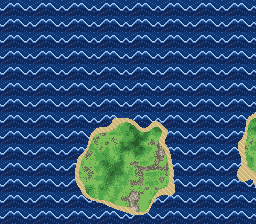

# Tile Ring

> An archipelago of 1280x896 pixels drawn with 1,433 distinct 8x8
> characters, scrolled in all eight directions. A tilemap entry names 1,024
> characters at most: the whole set never fits VRAM, and it does not need
> to. The screen never shows more than 389 of them, and the `tilering`
> module keeps those in a ring of 640 character slots, loading each column
> and row as it comes into view.



## Controls

| Button | Action |
|--------|--------|
| (none) | The camera flies a fixed course on its own: up, across, diagonals, home |
| D-Pad | Take the camera (2 px a frame) |
| B (held) | Fast: 7 px a frame |
| START | Give the course back |

## What You'll Learn

- Why a big hand-drawn map does not fit a tilemap's 1,024 characters, and why
  the screen's share does
- A ring of character slots: a count per slot, free slots taken in sequence,
  a freed character kept until its slot is needed again
- A 64x32 tilemap as a window that follows the camera on both axes
- What a frame of scrolling costs in the vertical blank, NTSC and PAL, and
  who decides how much may be spent: the game

## SNES Concepts

### The 1,024 characters of a tilemap entry

A background tilemap entry is 16 bits: 10 for the character, 3 for the
palette, priority and the two flips. With sprites and a status bar taking
their share of the 64 KB of VRAM, a 4 bpp background usually gets 512 to 768
characters. The archipelago has 1,433 once mirrored copies are merged
(`opensnes-tilering inspect res/archipelago.png`):

```
archipelago.png: 160x112 characters, 1433 distinct (1443 without merging
mirrors), 45856 bytes; window 33x29: worst 389 in view (at 13, 12), 26 new
a row, 23 a column
```

The converter tried every position of a 33x29 window (what a 256x224 screen
shows at any scroll): at most 389 distinct characters in view, at most 26 new
ones in a row that comes in, 23 in a column.

### The ring

The map is converted with its own numbering: each character once, numbered by
first appearance from the bottom row up. The module keeps 640 slots at VRAM
$0000-$27FF (`RING_SLOTS`). Each slot counts the cells of the window that
show it. When the camera crosses a column, the column that leaves releases
its slots, the column that comes in takes its own; a character not in the ring
takes the next free slot from a cursor that goes round. A slot at 0 keeps its
character: if the camera comes back first, nothing is sent.

### The window

The tilemap is 64x32 entries at $3000. Map cell (x, y) lives at tilemap cell
(x mod 64, y mod 32); the 33x29 cells in view never collide. Each frame the
module writes the column (one or two VRAM queue entries) and the row (two)
that came in.

## How It Works

### 1. The converted map and the work areas

```c
static const TileRingMap world = archipelago_TILERING_MAP;   /* res/archipelago.inc */
TileRing ring;
FAR u16 slot_of[archipelago_CHARS];   /* the slot of each character */
FAR u16 char_of[RING_SLOTS];          /* the character of each slot */
FAR u8 refs[RING_SLOTS];              /* the count of each slot */
FAR u8 staging[TILERING_STAGING_BYTES(33, 29)];
```

The build converts `res/archipelago.png` with the settings file beside it
(`tool = "opensnes-tilering"`).

### 2. The first screen, in force blank

```c
tileRingInit(&ring, &world, CHR_VRAM, 0, RING_SLOTS, MAP_VRAM,
             slot_of, char_of, refs, staging);
tileRingFill(&ring, camx, camy);
setScreenOn();
```

### 3. Every frame

```c
tileRingUpdate(&ring, camx, camy);    /* queues what changed */
bgSetScroll(0, camx, camy);
WaitForVBlank();
vramQueueFlush();                      /* sends it, first thing in VBlank */
```

### 4. The figures

The course is 1,052 frames. The example keeps what it measured in `tr_*`
variables, which the tests read (`testing/manifests/scrolling_tile_ring*.toml`,
`testing/tile_ring_budget.py`):

| | staging (default) | direct (`tr_direct = 1`) |
|---|---|---|
| new characters in a frame, at most | 21 | 21 |
| VRAM queue entries in a frame, at most | 5 | 22 |
| flush, worst frame (luna) | 7,994 master cycles | 19,270 |
| with the NMI handler, share of the NTSC blank (50,468) | 28 % | 51 % |
| share of the PAL blank (118,668) | 12 % | 21 % |

Staging copies the frame's new characters to a WRAM buffer (DMA from ROM,
outside the blank), so they leave in one transfer per run of consecutive
slots; direct sends each run of characters from ROM, without the copy and the
2 KB of RAM, at about 80 bytes of the blank per extra transfer.
`tileRingCost(&ring, 7, 0)` says 23 characters at most for a frame at 7 px
across, `tileRingCost(&ring, 5, 5)` 49 for the diagonal: the converter's
figures, an upper bound the course does not reach.

## Assets

`res/archipelago.png` is invented, drawn by `devtools/art_assets/tile_ring.py`
from a fixed seed: a sea on a mirrored 32x16 motif (a handful of characters for
the whole sea) and six islands whose grass and rock are value noise, so that
nearly every land character is distinct.

## Build & Run

```bash
cd $OPENSNES_HOME
make -C examples/scrolling/tile_ring
```

Then open `tile_ring.sfc` in luna (or any SNES emulator).

## Modules Used

console, background, input, tilering, vramqueue
