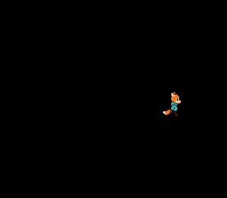

# Animated Sprite -- Direction States and Sprite Sheets



## What This Example Shows

How to animate a character sprite that walks in 4 directions with 3 animation frames
each. Demonstrates sprite sheet layout, direction state machines, and horizontal flip
to reuse art.

## Prerequisites

Read `sprites/simple_sprite` first (OAM basics, tile loading).

## Controls

| Button | Action |
|--------|--------|
| D-PAD Up | Walk up |
| D-PAD Down | Walk down |
| D-PAD Left | Walk left (flipped) |
| D-PAD Right | Walk right |

## Build & Run

```bash
cd $OPENSNES_HOME
make -C examples/sprites/animated_sprite
```

Then open `animated_sprite.sfc` in luna (`luna-gui animated_sprite.sfc`) or any emulator.

## How It Works

### 1. Sprite sheet layout

The sprite sheet is a column of fifteen 32x32 frames of Kit seen from above:
five walking down, five walking up, five walking to the right. It is loaded
to VRAM at startup via `oamInitGfxSet()`. The converter lays 32x32 blocks out
four to a 128-pixel row of OBJ VRAM, so block `k` starts at tile
`(k % 4) * 4 + (k / 4) * 64`:

- Walking down (blocks 0-4): tiles 0, 4, 8, 12, 64
- Walking up (blocks 5-9): tiles 68, 72, 76, 128, 132
- Walking right (blocks 10-14): tiles 136, 140, 192, 196, 200
- Walking left: same as right, but with `OBJ_FLIPX`

### 2. State machine

```c
enum SpriteState {
    W_DOWN = 0,
    W_UP = 1,
    W_RIGHT = 2,
    W_LEFT = 2  /* Reuses W_RIGHT with flipx */
};
```

Left and right share the same animation row -- the PPU's horizontal flip flag
(`OBJ_FLIPX`) mirrors the sprite at zero CPU cost. This is a standard SNES
technique that halves the sprite art needed for left/right movement.

### 3. Animation timing

One clip per facing, from the `anim` module; the clip holds the tile numbers
and the cadence:

```c
DECLARE_ANIM_CLIP(walk_down, ANIM_LOOP, ANIM_DELAY, 0, 4, 8, 12, 64);

animPlay(&kit_anim, &walk_down);       /* continues if already playing */
kit.gfx_frame = animTick(&kit_anim);   /* the tile number for oamSet() */
```

Animation only advances when a direction button is held. `ANIM_DELAY` (6 frames)
controls walking speed -- at 60 fps, this means about 10 animation steps per second.

## SNES Concepts

### OBJ_FLIPX -- Hardware Horizontal Mirror

The PPU can flip any sprite horizontally by setting a single bit in the OAM
attribute byte. This costs nothing -- no extra tiles in VRAM, no CPU work.
Many SNES games use this to halve the sprite art needed for left/right movement.

### Sprite Sheets in VRAM

All animation frames are loaded into VRAM at once via `oamInitGfxSet()`. The
active frame is selected by changing the tile number in `oamSet()`. This means
switching frames is instant -- just change a number, no DMA needed.

### 32x32 Tiles in OAM

In OAM, a 32x32 sprite uses 16 hardware 8x8 tiles arranged in a 4x4 grid. The
tile number refers to the top-left tile; the PPU fills in the rest automatically
using the SNES tile numbering convention (right tile = tile+1, each row below is
16 tiles further, the 16-tile-per-row VRAM layout). `OBJ_SIZE16_L32` makes
"large" mean 32x32, and `oamSetSize(0, OBJ_LARGE)` picks it for this sprite.

## Project Structure

| File | Purpose |
|------|---------|
| `main.c` | Input handling, state machine, animation logic |
| `res/kit_walk.png.toml` | the import settings of the sprite sheet (`opensnes-sprite`: 32-pixel blocks, 16 colours); the build converts the PNG and links the result, `res/kit_walk.inc` declares the symbols |
| `res/kit_walk.png` | Kit's walk seen from above, 15 frames of 32x32 in a column; generated for OpenSNES, CC0 (`assets/neo-lumen/`) |
| `Makefile` | `LIB_MODULES := console sprite dma input` |

## Going Further

- **Add diagonal movement**: Check for simultaneous Up+Right, Down+Left, etc.
  Choose a direction state based on the last-pressed direction.

- **Variable walk speed**: Use fixed-point positions (8.8 format) for sub-pixel
  movement. This gives smoother motion at speeds between 1 and 2 pixels per frame.

- **Explore related examples**:
  - `sprites/dynamic_sprite` -- Stream frames instead of pre-loading all of them
  - `games/breakout` -- Multiple sprites interacting with game logic

## Modules Used

`console`, `sprite`, `dma`, `input`, `anim` (`LIB_MODULES` in the Makefile).
