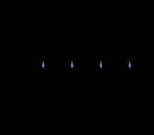

# Dynamic Sprite -- VRAM Streaming for Animated Sprites



## What This Example Shows

How to use the **dynamic sprite system** to stream sprite tile data into VRAM every frame.
Unlike static sprites (where all frames live in VRAM permanently), dynamic sprites upload
only the current animation frame, saving VRAM space when sprites have many frames.

This demo displays 4 animated 16x16 sprites, each cycling through 24 frames of animation.
SELECT switches to the next step of the same engine: **metasprites**, characters built
from several OBJ, streamed the same way under the three OBJSEL size pairs.

## Prerequisites

Read `sprites/simple_sprite` first (OAM basics), then `sprites/animated_sprite`
(frame-based animation).

## Controls

| Button | Action |
|--------|--------|
| SELECT | Switch between the four animated sprites and the metasprite scene |
| D-PAD Up/Down | (metasprite scene) switch the OBJSEL size pair: 8/16, 8/32, 16/32 |

At boot the four sprites animate by themselves.

## Build & Run

```bash
cd $OPENSNES_HOME
make -C examples/sprites/dynamic_sprite
```

Then open `dynamic_sprite.sfc` in luna (`luna-gui dynamic_sprite.sfc`) or any emulator.

## How It Works

### 1. Initialize the dynamic sprite engine

```c
static const OamDynamicConfig dyn = {
    .vramLarge      = 0x0000,
    .vramSmall      = 0x1000,
    .slotLargeInit  = 0,
    .slotSmallInit  = 0,
    .sizeMode       = OBJ_SIZE8_L16,
};
oamDynamicInit(&dyn);
```

This configures the engine:
- VRAM base for large tiles: `$0000`
- VRAM base for small tiles: `$1000`
- Sprite size pair: 8x8 small / 16x16 large

### 2. Set up sprites via the oambuffer

```c
oambuffer[0].oamx = 64;
oambuffer[0].oamy = 100;
oambuffer[0].oamframeid = 0;
oambuffer[0].oamattribute = OBJ_PRIO(3);
oambuffer[0].oamrefresh = 1;
OAM_SET_GFX(0, spr16_tiles);
```

Each dynamic sprite has:
- **oamframeid**: which animation frame to display (index into the sprite sheet)
- **oamrefresh**: set to 1 when the frame changes -- tells the engine to re-upload tiles
- **OAM_SET_GFX**: points to the source tile data in ROM

### 3. Draw and upload every frame

```c
oamDynamicDraw(0);   /* Queue sprite 0; NMI auto-flushes the VRAM tile
                      * queue and hides last frame's leftovers. */
```

The draw call runs every frame in the main loop. Only sprites with
`oamrefresh = 1` actually trigger a DMA transfer. The NMI handler
finalises the frame automatically — it hides leftover sprites, resets
the slot allocator, and DMAs the queued tiles to VRAM — so user code
never needs to issue a manual flush.

### 4. Animate by changing frame IDs

```c
frame0++;
if (frame0 >= 24) frame0 = 0;
oambuffer[0].oamframeid = frame0;
oambuffer[0].oamrefresh = 1;
```

Every 8 frames, the animation advances. Setting `oamrefresh = 1` tells the engine
to upload the new frame's tiles to VRAM on the next VBlank.

## The Metasprite Scene

A metasprite is a list of pieces, each an offset, a tile and attributes:

```c
static const MetaspriteItem hero16_frame0[] = {
    METASPR_ITEM(0,  0,  0, OBJ_PAL(0) | OBJ_PRIO(3)),
    METASPR_ITEM(16, 0,  1, OBJ_PAL(0) | OBJ_PRIO(3)),
    ...
    METASPR_TERM
};
oamMetaDrawDyn(10, 192, 140, hero16_frame0, spritehero16_tiles, OBJ_SMALL);
```

`oamMetaDrawDyn(id, x, y, meta, gfx, size_class)` streams each piece's tiles
with the dynamic engine; `OBJ_SMALL` / `OBJ_LARGE` say which half of the
OBJSEL pair the pieces use. Changing the pair (UP/DOWN) re-runs
`oamDynamicInit()` with a new `sizeMode` under force blank, and
`oamDynamicDrainQueue()` uploads both heroes before the screen comes back
on. The menu is text on BG1 (Mode 0, font at VRAM $3000, map at $3800);
the engine's tiles stay at $0000 (large) and $1000 (small). The scene was the
`dynamic_metasprite` example, a port of PVSnesLib's DynamicEngineMetaSprite.

## SNES Concepts

### VRAM Budget During VBlank

The SNES can only write to VRAM during VBlank. With DMA, you get roughly 4-5 KB
per frame. Each 16x16 sprite frame is 128 bytes (4 tiles x 32 bytes). With 4
sprites updating simultaneously, that is 512 bytes -- well within budget.

### Static vs Dynamic Sprites

- **Static**: All frames pre-loaded in VRAM. Frame selection is instant (just change
  the tile number). Downside: a 24-frame sprite uses 3 KB of VRAM permanently.
- **Dynamic**: Only the current frame lives in VRAM. Supports hundreds of frames
  with minimal VRAM usage. Downside: each frame change costs DMA time during VBlank.

Dynamic sprites are the right choice when sprites have many animation frames (RPG
characters with walk cycles, attack animations, etc.) or when multiple unique
characters share limited VRAM space.

### Force Blank for Initial Setup

This demo uses `setScreenOff()` (which sets `REG_INIDISP = 0x80`) during setup to
allow unlimited VRAM writes. During gameplay, writes happen via DMA in VBlank only.

## Project Structure

| File | Purpose |
|------|---------|
| `main.c` | Dynamic sprite initialization, animation loop |
| `res/sprite16_grid.png.toml`, `res/sprite32.png.toml` | the import settings of the two sheets (`opensnes-sprite`); the build converts them and links the result, `res/sprite16_grid.inc` declares the symbols |
| `res/sprite16_grid.png` | 16x16 sprite sheet source |
| `Makefile` | `LIB_MODULES := console sprite sprite_dynamic sprite_lut dma background input` |

## Going Further

- **Move sprites with input**: Add `padHeld()` and update `oambuffer[0].oamx/oamy`
  based on D-pad direction.

- **Mix static and dynamic**: Use static sprites for simple objects (bullets, UI
  elements) and dynamic sprites for complex animated characters.

- **Explore related examples**:
  - `games/breakout` -- Dynamic sprites in a real game context
  - `games/likemario` -- Dynamic sprites with scrolling backgrounds

## Modules Used

`console`, `sprite`, `sprite_dynamic`, `sprite_dynamic_meta`, `sprite_lut`, `dma`, `background`, `text`, `input` (`LIB_MODULES` in the Makefile).
