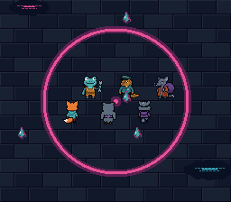

# World Sprites



A square of the Rue basse seen from above, 512 × 448: seventeen data shards
drift over the paving, six residents — Kit, a frog, an owl, a pangolin, a
raccoon and a rat — pace up and down round the neon ring at its centre, and
the D-pad scrolls a 256 × 224 view of it (BG1, a 64 × 64 map, scrolls with
the camera).
Every frame the example hands its world-space arrays to `oamPlaceWorld()`,
once per batch: the call subtracts the camera, hides what is off screen,
writes the OAM entries and the ninth x bit, and reports in `visible[]`
which sprites it placed — the loop a scrolling game runs every frame, in
assembly. The residents are sorted by depth and the batch's `order` says
which resident each slot shows, the way a game seen from above sorts its
actors; each faces the way it walks (its back turned going up).

## SNES Concepts

- World coordinates minus a camera give screen coordinates; a sprite partly
  off the left edge needs the ninth x bit (x in 256..511), which the PPU
  reads as negative.
- OAM culling: a sprite off screen is hidden (x = 257, y = 240), not left
  where it was.
- OAM order is drawing order: the lower slot is in front. Seen from above,
  the sprite lower on the screen is nearer, so the residents are sorted by y
  every frame (an insertion sort of six bytes) and `order` permutes the
  slots — the arrays stay indexed by the resident, nothing is copied.
- Structure of arrays (one array per property) is what the 65816 indexes
  cheaply; an `OamWorldBatch` is filled with their addresses once.
- A batch has one size: the shards are the SMALL size of `OBJ_SIZE16_L32`
  (16 × 16), the residents the LARGE one (32 × 32), set once with
  `oamSetSize()`: the call never touches the size bit.
- A sprite's frame is its entry of the batch's `tile` array: a resident
  walking up gets its north frame, one walking down its south frame, and
  the call writes whichever is there. Each resident has its OBJ palette
  (1 to 6, in its attribute); the shards share palette 0.
- `visible[]` tells the game which sprites were placed — here it counts
  the shards in view; a game reads it to stream the animation frames of
  the sprites that are shown and skip the others, so that a sprite off
  screen costs no VRAM DMA.
- A batch costs the same whether its sprites are on screen or not (the
  call tests each one); a game that hides a whole group skips the call
  with a flag of its own rather than placing hidden sprites.

## Controls

| Button | Action |
|--------|--------|
| D-pad | Scroll the camera (and the paving), up to the kerb |

## How to Build

```bash
make
```

## VRAM Layout

| Region | Content |
|--------|---------|
| $0000 | BG1 tilemap, 64 × 64 (four 32 × 32 pages, 8 KB) |
| $1000 | BG1 tiles: the square, 275 tiles (4bpp) |
| $4000 | OBJ tiles: twelve frames of the residents, then the shard (tile 192) |

## Assets

| File | What it is |
|------|------------|
| `res/plaza.png` | the square, 512 × 512: running-bond paving, the kerb and its cyan strip, the pink ring, manhole covers, puddles holding the neon |
| `res/residents.png` | the sheet, 128 px wide (one row of OBJ tiles): frame 2k resident k facing south, 2k + 1 facing north; the shard at the start of the fourth row |
| `res/*.png.toml` | the import settings (`opensnes-tileset`, `opensnes-sprite`); the build converts and links them |

The residents and the shard are Néo-Lumen art (PixelLab, CC0); the square is
drawn by `devtools/art_assets/build.py`, which also lays out the sheet
(`assets/neo-lumen/README.md`).

## Modules Used

`console`, `dma`, `background`, `sprite`, `input`
