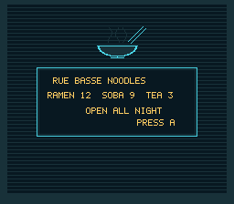

# Pixel Text



The menu screen of a noodle bar's terminal in the Rue basse: a bowl over a
message panel, and in the panel four lines of a narrow font at a 6-pixel pitch, none of them on the tile
grid, composed in RAM and sent to VRAM: the `text` module puts one glyph per
tile, and a game that wants proportional text, or a label at any x and y,
composes its own 2bpp layer. The primitive is `tileBlitGlyph2bpp()`, which
ORs rows of a glyph into one tile and the tile to its right at a pixel
shift; two calls per glyph cover the four tiles a glyph at (x, y) can touch.
Press A and every line moves one pixel right, the glyphs crossing tile
boundaries as they go. The text is not an asset: a 5x7 font declared as bits
becomes 2bpp glyphs at boot.

## SNES Concepts

- A 2bpp tile is 16 bytes, planes 0 and 1 interleaved per row. A layer of
  160 tiles is 2560 bytes in FAR RAM, and tile n of the layer is tile n of
  the sheet in VRAM: the tilemap only places the tiles, the pixels are
  whatever the layer holds.
- A glyph at x covers tile x / 8 and, shifted by x % 8, the tile after it;
  at y it covers rows y % 8 to 7 of one tile row and rows 0 to y % 8 - 1 of
  the next. The slot to the right is the next tile of the layer, the slot
  below is one row of tiles further.
- The call only ORs, so the layer is cleared with `memset()` before a new
  layout, and glyphs may overlap.
- After a change the layer goes to VRAM in two halves of 1280 bytes, one
  per VBlank, inside the DMA budget of a frame.
- Cost: about 12 000 master cycles a glyph for its two calls (measured on
  luna), where the same work in C costs 40 000 to 50 000.

- Mode 0 gives each BG its own palettes: the layer (BG1) uses CGRAM 0-3,
  the terminal behind it (BG2) CGRAM 32-35, and colour 0 of each is
  transparent, so the glass shows between the letters.

## VRAM Layout

| Word address | Content |
|---|---|
| `$0400` | BG1 map: the layer's 160 tiles placed at column 6, row 10 |
| `$0800` | BG2 map: the terminal |
| `$1000` | BG1 tiles: the layer, then one blank tile |
| `$2000` | BG2 tiles: the terminal |

## Assets

| File | What | Made by |
|---|---|---|
| `res/terminal.png` | the bar terminal's screen, 256x224, four colours, 2bpp (`res/terminal.png.toml`) | `devtools/art_assets/build.py` (`bar_terminal`) |

The font is the `font5x7` table of `main.c`, drawn by hand, CC0 like the rest
of the Néo-Lumen assets (`assets/neo-lumen/README.md`).

## Controls

| Button | Action |
|--------|--------|
| A | Shift every line one pixel to the right (six steps, then back) |

## How to Build

```bash
make
```

## Modules Used

`console`, `dma`, `background`, `input`, `tile`, `string`
