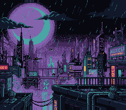

# Fade and Mosaic — Screen Transitions




The two transitions the PPU gives for free: a brightness fade and the mosaic
filter. Press any button to step through them: fade out and in at three
speeds, then the picture breaking into growing blocks and sharpening again.

## Learning Objectives

After this lesson, you will understand:
- How master brightness works, and why brightness 0 is not force blank
- How the mosaic filter groups pixels into blocks, and on which layers
- How the speed of a transition is set, and what it costs (nothing but one
  register write per step)
- How the two combine into the classic RPG battle transition

## SNES Concepts

- Master brightness, INIDISP ($2100) bits 0-3; force blank, bit 7
- The mosaic filter, MOSAIC ($2106): block size and per-layer enable
- Frame-paced transitions: one register write per step, timed by VBlank
- Sprites are not mosaicked; backgrounds are

## Prerequisites

- A background on screen (`backgrounds/mode1`)
- VBlank timing (`basics/game_skeleton`)

## Controls

| Button | Action |
|--------|--------|
| Any button | Next transition |

The cycle: fade out / in at 1 frame per step, at 3, at 6, then mosaic out,
mosaic in, and again.

## How It Works

### 1. Brightness: INIDISP ($2100)

```c
fadeOut(1);   /* 15 -> 0, one step per frame: 16 frames, a quarter of a second */
fadeIn(3);    /* 0 -> 15, one step every 3 frames */
```

Bits 0-3 of INIDISP are the master brightness, 0 (black) to 15 (full); bit 7
is force blank. `fadeOut(speed)` and `fadeIn(speed)` (`snes/console.h`) step
the brightness once every `speed` frames:

| Speed | Frames per step | Whole fade |
|-------|-----------------|------------|
| 1 | 1 | 16 frames, 0.27 s |
| 3 | 3 | 48 frames, 0.8 s |
| 6 | 6 | 96 frames, 1.6 s |

`fadeOut()` and `fadeIn()` hold the program for the whole fade: nothing else
runs meanwhile, the sound driver of a game that advances it from its main
loop included. For a fade that lets the loop go on, start it and give it
one call a frame:

```c
fadeStart(FADE_OUT, 6);          /* writes level 15 and returns */
do {
    WaitForVBlank();
    fade_ticks++;                /* what the loop does each frame */
} while (fadeStep());            /* 1 while it runs, 0 after 16 x 6 frames */
```

The two 6-frame fades of this example are these: `fade_ticks` reads 96 after
the first, one tick for every frame of the fade, and the brightness is the
blocking fade's at every frame (`testing/manifests/transition_fading.toml`
holds both).

**Brightness 0 is not force blank.** The screen is black but the PPU still
draws, so VRAM is still closed outside VBlank. To load a new scene, fade out,
then `setScreenOff()`, load, `setScreenOn()` and fade in.

### 2. Mosaic: MOSAIC ($2106)

```c
mosaicSetLayers(LAYER_BG1);   /* which backgrounds the filter applies to */
mosaicFadeOut(3);             /* block size 1x1 -> 16x16, 3 frames per size */

mosaicFadeIn(3);              /* 16x16 -> 1x1 */
mosaicDisable();              /* size 0 and no layer: the filter is off */
```

Bits 7-4 of MOSAIC are the block size minus one (0 = 1x1, 15 = 16x16), bits
3-0 the background layers it applies to. Each block takes the colour of its
top-left pixel: the picture looks like a lower resolution of itself, it is
not a blur. Sprites are never affected — only backgrounds — so characters can
stay sharp while the scene dissolves behind them.

### 3. Combining both

The classic battle transition of SNES RPGs:

1. mosaic out (the scene turns into blocks),
2. fade to black,
3. load the new scene in force blank,
4. fade in (still blocky),
5. mosaic in (the blocks shrink and the new scene appears).

## Build & Run

```bash
cd $OPENSNES_HOME
make -C examples/transitions/fading
```

Then open `fading.sfc` in luna (`luna-gui fading.sfc`) or any emulator.

## Modules Used

`console`, `sprite`, `dma`, `input`, `background`, `mosaic` (`LIB_MODULES` in the Makefile).

## Files

| File | Purpose |
|------|---------|
| `main.c` | the transitions, one per button press |
| `res/moonrise.png` (+ `.toml`) | the moon over the skyline, Néo-Lumen art (PixelLab, CC0) with its frame painted out by `devtools/art_assets/build.py`; the build converts it (`opensnes-tileset`), `res/moonrise.inc` declares the symbols |
| `vram.spec` | the VRAM regions of the example (`vram_map.h` is generated from it) |
| `Makefile` | build configuration |

## Exercises

1. **Scene change**: load a second picture and switch to it with the five
   steps of section 3.
2. **Per-layer mosaic**: put a second background on BG2 and mosaic BG1 only.
3. **Colour fade**: fade to white instead of black with colour math
   (`color/transparency`).

## What's Next?

- [Parallax scrolling](../../scrolling/parallax_scroll/) — several layers moving at different speeds
- [HDMA wave](../../hdma/hdma_wave/) — a register changed on every scanline
