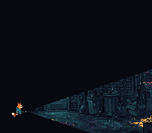
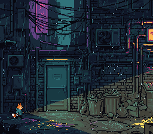

# Window -- HDMA Torch Beam: Masking and Lighting



Kit stands in a dark back alley with a torch. The beam is a window driven by
HDMA: its left edge changes every scanline, so the window is a cone that leaves
the torch and opens to the right. Press **A**, **X** or **B** and it masks
background layers — the alley, the rain in front of it, or both; press **Y** and
it marks where colour math lights the picture instead.



Ported from PVSnesLib's "Window" example; the colour-math mode is its
"TransparentWindow" example (by Digifox), adding instead of subtracting.

## Controls

| Button | Action |
|--------|--------|
| **A** | The beam on BG1 (the alley) only: the rain falls everywhere |
| **X** | The beam on BG2 (the rain) only: the alley is lit, the rain shows where the torch catches it |
| **B** | The beam on both BG1 and BG2 (the boot state) |
| **Y** | Light the beam: nothing is clipped, colour math brightens both BGs inside it |

## Build & Run

```bash
cd $OPENSNES_HOME
make -C examples/windows/window
```

Then open `window.sfc` in luna (`luna-gui window.sfc`) or any emulator.

## How It Works

### SNES Window System

The SNES PPU has two hardware windows -- regions defined by a left and a right X
coordinate. These windows can mask (hide) portions of any background layer or
sprite layer. Window operations cost zero CPU time because they are handled
entirely by the PPU.

### Making Non-Rectangular Shapes with HDMA

A single window is always a horizontal band. But by changing the left/right
boundaries **every scanline** using HDMA, you can create any shape -- circles,
cones, or custom silhouettes.

This example uses two HDMA channels:
- **Channel 4** writes to WH0 ($2126) -- window 1 left boundary
- **Channel 5** writes to WH1 ($2127) -- window 1 right boundary

### The Beam Tables

`buildBeam()` computes the two tables at boot from the shape they draw. The
torch's tip is at (44, 187); the cone widens by one line every three pixels:

```
Line   0-116:  WH0=255, WH1=0    -> left > right -> no window
Line 117-223:  WH0 = 44 + 3 x |line - 187| (255 past the screen), WH1 = 255
```

The beam lines use **repeat mode** (bit 7 set in the line count) because each
scanline needs a different value. Non-repeat mode would write once and hold,
which does not work when the shape changes per line.

### Inversion: Show Inside

By default, TMW (main screen window at $212E) hides pixels **inside** the window.
The code sets the **invert** flag in W12SEL ($2123) so that pixels **outside**
the window are hidden instead -- revealing only the beam.

### Kit Stays Visible

Kit is a sprite, and the window is not enabled on sprites (WOBJSEL and TMW's OBJ
bit stay 0), so he stands out in the dark whatever the beam masks.

### Switching Layers

When you press A/X/B, the code:
1. Disables HDMA channels
2. Resets all window registers via `windowDisableAll()`
3. Enables window 1 on the new layer(s) with inversion
4. Sets TMW for the new layer(s)
5. Re-enables HDMA

## SNES Concepts

### W12SEL Register ($2123)

This register controls Window 1 enable and inversion for BG1 and BG2:

| Bit | Purpose |
|-----|---------|
| 0 | BG1 Window 1 Invert |
| 1 | BG1 Window 1 Enable |
| 4 | BG2 Window 1 Invert |
| 5 | BG2 Window 1 Enable |

Setting both the enable and invert bits for a BG makes pixels **outside** the
window invisible, revealing only the windowed region.

### Lighting: the Window as the Region of Colour Math (Y)

Pressing Y keeps the same HDMA tables and changes what the window is for:

| Register | Value | Meaning |
|----------|-------|---------|
| W12SEL / TMW | `$00` / `$00` | no layer is clipped |
| WOBJSEL | `$20` | the colour window is window 1, not inverted: the beam |
| CGWSEL | `$10` | colour math only inside the colour window, from the fixed colour |
| CGADSUB | `$03` | add (bit 7 clear), on BG1 and BG2 |
| COLDATA | 6, 5, 2 | the warm colour added |

```c
windowEnable(WINDOW_1, WINDOW_MATH);       /* the colour window */
windowSetMainMask(0);                      /* nothing clipped */
colorMathSetCondition(COLORMATH_INSIDE);
colorMathSetSource(COLORMATH_SRC_FIXED);
colorMathSetOp(COLORMATH_ADD);
colorMathSetLayers(LAYER_BG1 | LAYER_BG2);
colorMathSetFixedColor(6, 5, 2);
```

The masking modes call `colorMathDisable()` first, so A, X or B after Y
clips again with no light left over. The same pattern draws a shadow
(subtract instead of add) or the darkened box behind a dialogue.

## VRAM Layout

| Region | Content |
|--------|---------|
| $0000 | BG1 tilemap (32x32) |
| $0400 | BG2 tilemap (32x32) |
| $1000 | BG1 tiles: the alley, 889 tiles (4bpp) |
| $5000 | BG2 tiles: the rain (4bpp) |
| $6000 | Kit (OBJ) |

A BG's tiles start on a $1000-word boundary (BG12NBA keeps the top four bits
of the address).

## Project Structure

| File | Purpose |
|------|---------|
| `main.c` | The beam tables, window setup, input loop, the falling rain |
| `res/alley.png` | BG1, the alley (palette slot 0) |
| `res/rain.png` | BG2, the rain on nothing (palette slot 1) |
| `res/kit.png` | Kit holding his torch, 32x32 |
| `res/*.png.toml` | the import settings (`opensnes-tileset`, `opensnes-sprite`); the build converts and links them, `res/<name>.inc` declares the symbols |
| `Makefile` | `LIB_MODULES := console sprite dma input background window hdma colormath` |

The alley and Kit with his torch come from PixelLab, the rain is drawn by
`devtools/art_assets/build.py` (CC0, `assets/neo-lumen/README.md`).

## Going Further

- **A moving beam**: rebuild the tables each frame with the tip following a
  sprite, or sweep the cone by changing its slope.

- **Circle window**: replace the cone with a circular profile calculated from
  the equation `x = sqrt(r^2 - y^2)`.

- **A rectangle**: a static box needs only three non-repeat entries per table
  (window empty, the edges for the box's height, empty again).

- **Explore related examples**:
  - `windows/window_multi_hdma` -- both windows shaped per scanline
  - `hdma/hdma_wave` -- another HDMA-driven per-scanline effect

## Modules Used

`console`, `sprite`, `dma`, `input`, `background`, `window`, `hdma`, `colormath` (`LIB_MODULES` in the Makefile).
